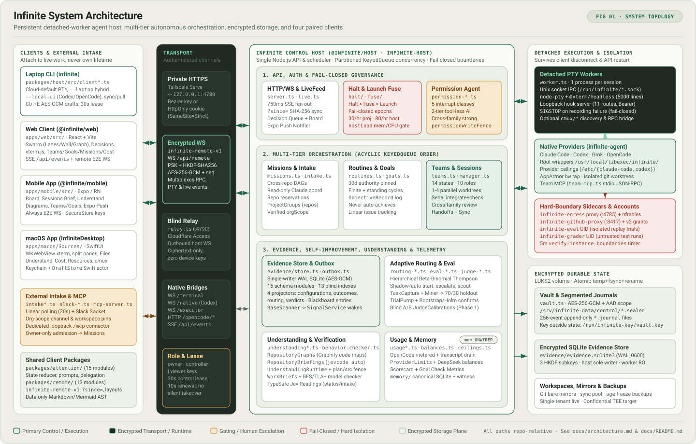

# Infinite

Infinite is a persistent agent host and autonomous orchestration runtime for Claude Code, Codex, Grok Build, and OpenCode. Agent processes run in detached workers on the host rather than inside a client tab or terminal window. The laptop CLI, browser client, native macOS app, and React Native phone app attach to those same live processes, recover full recorded output after disconnects, and coordinate multi-agent runs across repositories.

Closing a laptop, losing Wi-Fi, or restarting the API server leaves running agent workers alive.



For a file-level lookup map and a thematic guide to all 22 Architecture Decision Records ([`docs/adr/README.md`](docs/adr/README.md)), open the [Documentation and Research Index](docs/README.md). For protocols, state machines, storage schemas, and isolation boundaries, open [System Architecture](docs/architecture.md).

---

## Current Status and Boundaries

Infinite separates shipped runtime behavior from unattached foundations and unfinished design specs.

### Deployment Modes

| Mode | Target | Runtime status | Operator confidentiality |
| --- | --- | --- | --- |
| `single-tenant` (default; legacy alias `personal`) | Owner-controlled Ubuntu 24.04 server running all four native providers | Active pilot. Commissioned checks verify authenticated tool runs for all four providers, API-restart continuity, encrypted local backups/restores, and paired laptop CLI plus desktop and phone-sized browser access over Tailscale Serve HTTPS (native Android validation excluded). Optional egress/GitHub proxies, blind relay, and native macOS/mobile clients are implemented and configurable separately. | Owner trusts the host and guest root. Roles (`owner`, `controller`, `viewer`) share one tenant bucket. |
| `tenant-development` | Multi-tenant Proxmox KVM development boundary (`npm run host -- plan-fleet`) | Synthetic rehearsal only. Accepts only the `demo` provider; refuses native providers, remote access, cmux, and workspace sync. | None (`operatorConfidential: false`, `dataPolicy: "synthetic-only"`). |
| `confidential` | Managed multi-tenant confidential VMs (AMD SEV-SNP, Intel TDX, Confidential Space, or Nitro) | Hard-refused at init until hardware TEE attestation, measured immutable images, and user-controlled key release exist. | Target requires zero operator decryption. See [managed tenants](docs/multi-tenant.md). |

See the [commissioning record](deploy/ubuntu/commissioning.md) for verified host checks and remaining gaps (off-host backup uploads, cold-boot worker recovery, live Claude hook spike, physical-phone push delivery, and iOS native runtime signing).

### Subsystem Shipment Matrix

| Layer | Live-wired in host and clients | Implemented, not wired into live runtime | Spec-only or partial |
| --- | --- | --- | --- |
| Session Runtime and Transport | Detached PTY workers (`worker.ts`), AES-256-GCM vault and 256-record journals, `@infinite/attention`, verified answers, 30s control leases, SSE `/api/events`, `?since=` versioning, `infinite-remote-v1` E2E WS, blind relay, cmux bridge, `--laptop` Codex handoff, `--local-ui` Codex/OpenCode, batched workspace sync | None | Claude/Grok native UI adapters; automatic host-reboot worker recovery |
| Orchestration and Intake | `TeamService` (14 states, 10 roles), `GoalService` (finite and standing), `MissionService` (cross-repo DAG, read-only Claude coordinator), `RoutineService` (30d authority-pinned), `HandoffService`, `ProjectGroups`, Blackboard (`evidence/blackboard.ts`), Linear + Slack Socket intake with mandatory pinned `organizationScope`, external `/mcp` connector + internal stdio `infinite-team` MCP | `read-phases.ts` / `read-request.ts` (read-pool models), `search-engine.ts` (Search Mode pure state machine) | None |
| Governance and Security | `HaltService` autonomous-work halt, `FuseService` hourly launch fuse, `hostLoad` gate, 5-step `HostPermissionPipeline` (class rules v8, 2-tier tool-less cross-family review, `permissionWriteFence`) plus legacy repository-level `permission-coordinator` fallback, 7-account Ubuntu isolation, 3 `nftables` tables, egress and GitHub credential proxies, provider ceilings, freeze-watchdog `age` backups | None | Metered USD admission reservations (current fuse caps launch count, not dollars) |
| Evidence, Routing and Evaluation | Single-writer encrypted SQLite `EvidenceStore` (15 modules, 4 `EventOutbox` projectors), `ObjectiveRecord` + `TeamIntent` + `TeamRegister` + `TeamVerdicts`, `OutcomeLedger` + `BaseScanner` + `SignalService`, hierarchical Beta-Binomial Thompson `RoutingRecorder` (shadow/auto), `EvalHost` + `Grader` + `TrialPump` + Bootstrap/Holm comparisons + Phase 1 blind `JudgeCalibrations` | None | Live production duels (Phase 2), Improvement Gate candidate registry, Class A automated lesson/prompt adoption |
| Understanding, Telemetry and Memory | `RepositoryGraphs` (Graphify code maps), `RepositoryBriefings` (`jevcode auto`), `UnderstandingRuntime` + plan/source fence + `WorkBriefService`, finite BFS/TLA+ `BehaviorChecker`, TypeSafe Jev `Readings`, `UsageService` + `BalanceService` + `ProviderLimits` + `Scorecard` | `packages/host/src/memory/` (17-table encrypted SQLite store, Ed25519 witness recovery, Lexical and fail-closed `HonchoMemoryAdapter`), `deploy/ubuntu/memory/` Honcho v3.4.0 qualification suite | Honcho production ingestion and semantic recall (gated on AGPL-3.0 review and metered egress proxy) |

---

## Core Architecture and Monorepo Map

Infinite is a TypeScript and Swift npm-workspace monorepo built around one detached-worker host, two shared wire/protocol packages, three graphical clients, a laptop CLI, and Linux hardening templates.

```text
packages/
  attention/   @infinite/attention (16 modules): pure attention reducer, terminal prompt parser,
               spinner-immune screen activity, hook mappers (Claude/Codex), destructive detector, delegation gate
  remote/      @infinite/remote (13 modules): infinite-remote-v1 E2E WS cipher (HKDF + AES-GCM),
               ?since= list sync, data-only Markdown/Mermaid/diagram layouts, Understanding & Memory schemas
  host/        @infinite/host: Control API, detached PTY workers, vault/journals, encrypted SQLite
               EvidenceStore, Teams/Goals/Missions/Routines/Intake, Permissions/Halt/Fuse,
               Adaptive Routing, Replay Eval, Judge Calibration, Understanding, Usage, Laptop CLI, Relay
apps/
  web/         @infinite/web (React + Vite): Swarm (Lanes/Wall/Graph), Decision Queue, xterm.js,
               Sessions, Teams + Blackboard Inspector, Goals, Missions + Progress Inspector, Cost, Permissions, Halt, Dictation, Remote pairing
  mobile/      @infinite/mobile (Expo / React Native, Android-first, iOS config): Board, Sessions Brief,
               Understand & Diagrams, Teams + Evidence Sheet, Goals, Missions + Progress Inspector, Cost, Permissions, Dictation, Expo Push
  macos/       InfiniteDesktop (SwiftUI + CryptoKit): WKWebView xterm, split panes, Files & Sync,
               Understand (Knowledge + Behavior), Cost, Resources window, native cmux Noise client
deploy/
  ubuntu/      7-account Linux hardening, systemd units, sudoers, nftables (egress/eval/grader),
               provider ceilings, freeze-watchdog age backups, secondary instances, Honcho qualifier
  proxmox/     Synthetic-only multi-tenant KVM fleet planner (plan-fleet)
scripts/       Zero-dependency egress & GitHub proxies, GitHub App token refresher, Graphify builder,
               comment & file-size ratchets, macOS/CLI/Codex handoff builders, test runner
docs/          System architecture, 6 SVG diagrams, subsystem guides, 22 ADRs (docs/adr/)
tests/         Discovered test suites (tests/*.test.ts): unit, live PTY continuity, OS-boundary launchers,
               Playwright smoke, compile-time type tests, and seeded crash/fault/differential simulators
verification/  Formal finite-state safety models (Understanding refresh fence) + TLA+/TLC exports
```

### Five Design Invariants

1. **Detached execution and encrypted truth.** Every session runs in its own worker process (`packages/host/src/worker.ts`) behind a private Unix socket (`0600`). Output, input intent, receipts, and signals write to 256-record AES-256-GCM journal segments (`packages/host/src/vault.ts`) before or alongside PTY writes; a recording failure suspends the native process with `SIGSTOP` (`recording-error`) rather than continuing unrecorded.
2. **Receipts over inference.** A delivered receipt confirms bytes reached the PTY, never that an agent accepted or completed a task. Evaluator verdicts (`TeamVerdicts`) are provisional agent assessments and never mark a product goal `achieved` without an explicit human outcome (owner or controller). Merges are recorded as agent reports and validated against Git commits before a next cycle starts. No score, reward, routing decision, or usage figure enters an agent prompt.
3. **Fail-closed governance.** `HaltService` runs ahead of `FuseService` across autonomous and team launches (routines, goals, missions, teams, `Manager.createTeamSession` for `request.team` launches, replay eval trials, and main checks) as well as permission review and delivery, with zero exempt autonomous roles; an unreadable halt record fails closed across those gated autonomous launches and permission reviews host-wide. Separately, `FuseService` enforces rolling hourly launch limits across fuse-gated autonomous launches (`routines`, `goals`, `missions`, `teams`, and `Manager.createTeamSession`) and fails closed for non-exempt launches when its baseline is unreadable (`unmeasurable`), while exempting `permission-coordinator` and not gating `MainCheckService` (which checks halt and `hostLoad` directly). Ordinary interactive sessions started directly by the owner keep running during a halt and can still start—halt is an autonomous-work stop, not a host-wide kill switch for interactive sessions. Provider permissions stay with the owner unless explicitly delegated through one of two paths (check both when auditing): workspace-level delegation to the separate two-tier tool-less `HostPermissionPipeline` (where five interrupt classes—production/staging, credentials, money, destructive outside workspace, global/account settings—always escalate to the owner), or the legacy repository-level delegation (`project.team.permissions`, enabled by default on first `infinite repo init` unless `--permissions off`) that lets a strong `permission-coordinator` decide bounded one-shot requests for team runs not served by the permission agent.
4. **Partitioned concurrency and compile-time state machines.** Global mutexes and lockfiles have been replaced by per-entity `KeyedQueue` chains with strict acyclic lock ordering (`Routine -> Goal -> Mission -> Team -> Session`, [ADR-0016](docs/adr/0016-wave3-per-entity-orchestration-queues.md)), atomic temp-`fsync`-rename storage, Swift actors on macOS, and discriminated-union state machines pinned by compile-time `@ts-expect-error` tests ([ADR-0019](docs/adr/0019-orchestration-wire-and-domain-type-invariants.md)).
5. **Zero inline prose comments; invariants live in ADRs.** `npm run check:comments` enforces zero prose comments across all checked TypeScript, JavaScript, Swift, Python, C, shell, CSS, and systemd source files ([ADR-0003](docs/adr/0003-comment-policy-and-ratchet.md)). Non-obvious invariants live in [`docs/adr/0001`–`0022`](docs/adr/README.md).

---

## Quickstart

### Run a local development host

Requires Node.js 22.14+ and npm, plus native build tools for `node-pty` (C++/Python build tools on Linux; Xcode Command Line Tools on macOS).

```sh
npm ci
npm run build
npm run dev
```

Open **http://127.0.0.1:4780**. First run writes private `.local/config.json`, `.local/devices.json`, and `.local/secrets/vault.key`. Paste the generated owner key from `.local/devices.json` into the browser sign-in. Start a Rehearsal (`demo`) session to verify continuity without model calls, or inspect the host directly:

```sh
npm run host -- doctor --config .local/config.json
npm run host -- list --config .local/config.json
npm run host -- attach SESSION_ID --config .local/config.json
```

`Ctrl+]` detaches the terminal client; `Ctrl+C` interrupts the underlying agent. Closing any client or stopping the API server leaves worker processes running. Stop a session explicitly with `POST /api/sessions/:id/stop` or `infinite close SESSION_ID`.

To inspect the synthetic multi-tenant Proxmox planner (emits a secret-free plan without touching infrastructure):

```sh
npm run host -- plan-fleet deploy/proxmox/fleet.example.json
```

---

## Client Surfaces

All four clients authenticate against the same host API, respect `owner`, `controller`, and `viewer` roles, and enforce the worker's 30-second renewable input control lease (explicit takeover, never silent). See the [Understanding and Client Surface Matrix](docs/diagrams/understanding-and-clients.svg) for the full feature comparison.

### Laptop CLI (`infinite`)

Install via `make cli` (bundles into a content-hashed directory and symlinks `~/.local/bin/infinite`). Every provider runs on the cloud host by default, mapping the local checkout's home-relative path into a persistent cloud project. Put wrapper options before the provider name (`infinite --project ID --title "Task" codex`).

```sh
# Interactive cloud sessions & attachment
infinite claude
infinite codex --model MODEL
infinite grok
infinite opencode --model deepseek/deepseek-flash
infinite list
infinite resume SESSION_ID
infinite monitor SESSION_ID
infinite close SESSION_ID
infinite resources --watch
infinite cmux

# One-way workspace sync, hybrid laptop execution & experimental local TUI
infinite sync                         # incremental 256 KiB batched chunk upload
infinite pull PROJECT_ID --output DIR # export cloud tree into a new directory
infinite --laptop codex               # tools run locally; cloud handoff on loss (qualified backend)
infinite --local-ui codex "Prompt"    # local Codex TUI over cloud backend
infinite --local-ui opencode          # local OpenCode TUI (supports empty sessions)

# Orchestration, governance, evaluation & understanding
infinite projects
infinite board
infinite start "Task"
infinite mission progress MISSION_ID
infinite mission watch MISSION_ID
infinite team start "Task"
infinite team status TEAM_ID
infinite team watch TEAM_ID
infinite team watch TEAM_ID --board
infinite team entries TEAM_ID
infinite team steer TEAM_ID "Note"
infinite team answer TEAM_ID QUESTION_ID "Choice"
infinite routine list
infinite routing status PROJECT_ID
infinite permissions status
infinite halt
infinite fuse
infinite cost
infinite usage
infinite usage repairs
infinite understand check --file def.json
```

Additional CLI command families cover goals (`infinite goal`), autonomy (`infinite autonomy`), replay eval (`infinite eval`), judge calibration (`infinite duels`), and project signals (`infinite signal`). Press `Enter` to claim steering, `Ctrl+G` to monitor read-only, `Ctrl+E` for the AES-GCM encrypted local draft editor, or `Ctrl+]` to detach. See [CLI contract](docs/cli.md), [workspace sync](docs/workspace-sync.md), and [hybrid execution](docs/hybrid-execution.md).

### Browser (`apps/web`)

Opens on the read-only Swarm view (`#/swarm` Lanes, `#/swarm/wall` Tiles, `#/swarm/graph` Code Context Graph using Graphify code maps). Includes the Decision Queue (`#/decisions`, oldest-first prompts and decisions with keyboard selection), Sessions (Chat, Screen, full xterm.js Terminal, Project Files, Context), Teams (with blackboard evidence inspector and outcome groups), Goals, Missions (with live progress inspector), Cost, Permissions, Halt banner, Web Speech dictation cleanup, and paired remote machines over `@infinite/remote` encrypted WebSockets. Unsent drafts stay in tab memory and are never auto-sent on reconnect. See [Swarm view](docs/swarm.md).

### Native macOS App (`apps/macos`)

SwiftUI + CryptoKit desktop client (`npm run desktop:install`, requires macOS 14+ and Xcode Command Line Tools). Connects over `infinite-remote-v1` encrypted WebSockets (direct or relayed) and includes an independent native cmux client over Noise transport. Features WKWebView xterm.js terminals, side-by-side split panes, local prompt composer (`DraftStore` Swift actor sealed in Keychain), Home (Board), Understand (Workspace overview, Knowledge catalog, Behavior verification), Teams, Missions, Cost, Halt banner, Resources window, and hash-pinned chunked file transfer and folder sync preview. See [Infinite Desktop](docs/desktop.md).

### Phone App (`apps/mobile`)

Expo / React Native client (Android-first with iOS build configuration). Always connects over `@infinite/remote` encrypted WebSockets (direct Tailscale Serve HTTPS or blind relay behind Cloudflare Access), storing keys in Android Keystore or iOS Keychain via `expo-secure-store`. Features Board, Sessions (Attention Brief, Conversation, Activity, Read-only Files, Screen plus steering), Understand (Current vs Planned vs Difference, Work Briefs, native SVG diagrams, offline metadata cache), Teams (with blackboard evidence sheet and outcome groups), Goals, Missions (with live progress inspector), Cost, Permissions, native speech dictation (`ExpoSpeechRecognition`), and optional minimal-body Expo push notifications.

```sh
npm run android -w @infinite/mobile
npm run ios -w @infinite/mobile
```

Keep private EAS and Firebase identifiers out of tracked files (`apps/mobile/.local/eas.json` or `INFINITE_EAS_PROJECT_ID`, and `apps/mobile/.local/google-services.json` or `GOOGLE_SERVICES_JSON`). For an Android emulator against a local rehearsal host, forward ports with `adb reverse tcp:4780 tcp:4780 && adb reverse tcp:8081 tcp:8081` (development builds allow `http://127.0.0.1:4780`; release builds require HTTPS).

---

## Checks, Quality Ratchets and Verification

Run checks from the repository root (when working on Infinite checkouts from a workstation with an enrolled verification runner, dispatch through the cloud runner rather than running builds or tests locally):

```sh
npm run check                          # check:size + check:comments + typecheck + test + build
npm run lint -w @infinite/mobile
npm run typecheck -w @infinite/mobile
npm run export:android -w @infinite/mobile
npm run export:ios -w @infinite/mobile
```

`npm run check` enforces five gates in order:

1. **`npm run check:size`** (`scripts/check-file-size.mjs`): 1,000-line cap on new source files; downward-only baseline across 24 grandfathered files.
2. **`npm run check:comments`** (`scripts/check-comments.mjs`): zero-comment policy across `.ts/.tsx/.js/.mjs/.swift/.py/.sh/.c/.h/.kt/.css/.service/.timer/.socket` (`scripts/comments-baseline.json` is at `0`).
3. **`npm run typecheck`**: TypeScript strict check across all workspaces plus `tsconfig.type-tests.json` (`@ts-expect-error` state-machine and wire-contract tests).
4. **`npm test`** (`scripts/run-tests.mjs`): discovers every top-level `tests/*.test.ts` file, running parallelizable suites concurrently (default concurrency 4; override with `--concurrency=` or `INFINITE_TEST_CONCURRENCY=1` on small runners) followed by contention-sensitive suites listed in `serialFiles` sequentially, covering 12-PTY live API-restart continuity, vault/SQLite crypto, OS-boundary eval/grader launchers, Playwright browser smoke, and seeded crash/fault/differential simulators.
5. **`npm run build`**: sequential build of `@infinite/attention -> @infinite/remote -> @infinite/host -> @infinite/web`.

End-to-end browser verification against a disposable host uses `.agents/skills/verify-infinite/scripts/drive.mjs session --instance DIR`.

---

## Documentation and Research Map

Open the [Documentation and Research Index](docs/README.md) for task-based reading paths, a 29-entry "Where to look in code" lookup table, and the thematic map of all 22 ADRs.

| Area | Primary docs | Graphics |
| --- | --- | --- |
| System Architecture | [docs/architecture.md](docs/architecture.md), [docs/README.md](docs/README.md), [PRODUCT.md](PRODUCT.md), [DESIGN.md](DESIGN.md) | [System Topology](docs/diagrams/system-topology.svg) |
| Session Continuity, CLI and Clients | [docs/cli.md](docs/cli.md), [docs/desktop.md](docs/desktop.md), [docs/remote-machines.md](docs/remote-machines.md), [docs/workspace-sync.md](docs/workspace-sync.md), [docs/hybrid-execution.md](docs/hybrid-execution.md), [docs/native-continuity.md](docs/native-continuity.md) | [Session Protocol and Permissions](docs/diagrams/session-protocol-and-permissions.svg), [Understanding and Clients](docs/diagrams/understanding-and-clients.svg) |
| Orchestration, Intake and MCP | [docs/teams.md](docs/teams.md), [docs/missions.md](docs/missions.md), [docs/swarm.md](docs/swarm.md), [docs/intake.md](docs/intake.md), [docs/mcp.md](docs/mcp.md) | [Orchestration Hierarchy](docs/diagrams/orchestration-hierarchy.svg) |
| Evidence, Routing, Eval and Understanding | [docs/architecture.md#evidence-store-self-improvement-and-evaluation](docs/architecture.md#evidence-store-self-improvement-and-evaluation), [docs/repository-briefings.md](docs/repository-briefings.md), [docs/repository-graphs.md](docs/repository-graphs.md), [docs/behavior-verification.md](docs/behavior-verification.md) | [Self-Improvement Loops](docs/diagrams/self-improvement-loop.svg), [Understanding and Clients](docs/diagrams/understanding-and-clients.svg) |
| Security, Isolation and Operations | [docs/security.md](docs/security.md), [docs/multi-tenant.md](docs/multi-tenant.md), [docs/hosting.md](docs/hosting.md), [deploy/ubuntu/README.md](deploy/ubuntu/README.md), [deploy/ubuntu/commissioning.md](deploy/ubuntu/commissioning.md), [deploy/proxmox/README.md](deploy/proxmox/README.md) | [Security Boundaries](docs/diagrams/security-boundaries.svg) |
| Invariants and Decision Records | [docs/adr/README.md](docs/adr/README.md) (ADR-0001 through ADR-0022), [docs/research/agent-runtimes/README.md](docs/research/agent-runtimes/README.md) | None |
