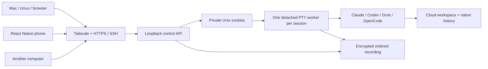

# Session ownership and protocol

This page describes the implemented **single-tenant runner**. The managed service now requires a separate runner and confidential execution boundary per user. Global control-plane accounts must never become runner data-access roles. See [managed tenants](multi-tenant.md) for the accepted architecture, hardware limitation, development backend, and confidential release gates.

The native UI and checkpoint requirements are refined in [native interaction and continuity](native-continuity.md), including source reviews of Herdr and Orca. The runner now implements separate runtime identity, snapshot-plus-delta attachment, per-worker capability negotiation, and device-control ownership. A cloud PTY preserves execution but cannot provide local-speed echo over a slow network. Experimental native frontend/backend adapters exist for Codex and OpenCode. Compact chat shows explicit recorded messages and available cmux native transcripts; complete structured transcripts across all providers remain future work. Codex workspace preparation and handoff are described below.

## Execution model

[Goals and agent teams](teams.md) add durable scheduling above the same detached
workers. A Goal retains the approved outcome, scope, deadline, attempt limits,
and model lineup, then starts sequential Team cycles from reviewed commits. A
Team validates role reports, optionally runs one discovery batch, schedules
independent tasks in separate Git copies, serializes integration, and runs
configured checks. Escalation uses a bounded, recorded replacement assignment.

Goal control and Team execution have separate revisions and replayable request
identities. Public control of a goal-owned Team goes through its Goal; current
member questions stay on the Team. Agent reports and passing checks never mark
a product goal achieved. That state requires an explicit user assessment.
Existing provider permissions and session input leases remain authoritative;
headless OpenCode workers can reject a permission request without a dialog.

Every provider runs on the selected machine by default; `Session.executionLocation` records `cloud` or `laptop`. Codex accepts `--laptop`, which keeps the invoking laptop project as the executor while its conversation backend stays in the cloud, with background preparation and automatic handoff as described in [laptop execution mode](hybrid-execution.md). Native CLI launches without `--project` resolve the local home-relative checkout path into a persistent cloud project and retain the relative launch directory. That cloud project is kept current by the one-way [workspace sync](workspace-sync.md) service. Reconnecting keeps the same conversation and placement.

The native process lives under its worker, not the HTTP server. An API crash leaves workers alive. Each worker owns its recording and input receipt map. The single HTTP listener binds only to `127.0.0.1`; Tailscale Serve can provide private HTTPS. A laptop can use ordinary SSH from a cmux pane to run `infinite attach SESSION_ID` on the host. Web and phone clients can also select independently paired machines. An optional outbound runner connection reaches an opaque relay, which forwards encrypted requests into the same authorized API. The optional cmux backend discovers existing Claude Code and Codex conversations and creates new cmux workspaces. Its process lifecycle and snapshot recording differ from detached Infinite workers. [Remote machines](remote-machines.md) defines those contracts and setup; neither backend changes execution ownership merely because a client switches machines.

## State and failure behavior

`starting → running → exited`. An unreachable worker is reported as `unavailable`, never “completed.” Recording failure sets `recording-error` and attempts to suspend the native process with SIGSTOP. This favors preserving the record over continuing silently without one. Operator intervention is required if storage fills.

Browser/network loss does not change worker state. API restart discovers existing workers through their private sockets and existing encrypted metadata. Host power loss, a native crash, or loss of the worker process is a different failure: the recording remains, but the process is not recreated automatically. An owner can explicitly resume a confirmed exited conversation with a known native ID for supported providers; this creates a fresh runtime and recording without resending its original prompt. Unknown or unavailable runtimes cannot be resumed this way. There is no second cloud host or high availability claim.

Terminal-native input can include arbitrary keyboard sequences over owner-only terminal connections or SSH/local IPC. Web/mobile text input rejects escape/control injection. Multiline paste is allowed only after the terminal application advertises bracketed-paste support. Explicit Enter/Escape/arrow/interrupt controls handle provider menus. None of these controls infer tool approval.

## Delivery contract

Creation uses a client UUID as the logical session ID. The stored request fingerprint makes an identical retry return the existing session; a conflicting reuse fails. Creation does not automatically retry spawning after an ambiguous failure.

New session metadata also pins a separate runtime UUID, execution location, and transport. Records written before execution location was stored are reported as `laptop` when they carry a hybrid workspace and `cloud` otherwise. Detaching and reconnecting never change that runtime. Authenticated Claude/Codex hooks may identify the native conversation; absence means unknown. Native argument passthrough does not inject hooks, so such sessions may have no native conversation mapping. This is not a portable recovery checkpoint or a complete provider-account binding.

Input carries a client-generated `requestId`. The worker durably appends intent, writes to the PTY, then durably appends the result. Concurrent identical retries return one receipt. If the write may have happened but the result was not recorded, that ID remains uncertain. It must not be silently reissued under another ID. Exactly-once execution of a provider's tool is not guaranteed by exactly-once terminal input.

Each event has `seq`, `at`, `type`, and `data`. The encrypted journal uses 256-record segments. `GET /api/sessions/:id/events?after=N&limit=200` returns `{events,cursor,more}`. Clients advance only to a received cursor and page until `more=false`. Events are retained after native process exit. There is no automatic record deletion or retention quota yet.

`GET /api/events?topics=sessions,teams,session/<id>&after=<cursor>` provides the shared live feed as authenticated `text/event-stream`. One host loop runs every 750 ms only while it has subscribers. Each tick reads each requested list or session state once, reads a session's journal page from the lowest active subscriber cursor, and emits only when the serialized topic data changes. `sessions` matches `GET /api/sessions`, `teams` matches `GET /api/teams`, and `session/<id>` contains the `GET /api/sessions/:id` detail plus a journal page shaped like `GET /api/sessions/:id/events`. The stream sends a comment heartbeat every 15 seconds, disables proxy buffering, and stops work when its last subscriber closes. It uses the same paired-device authentication and read roles as those GET routes.

HTTP subscriptions share a four-stream cap per paired credential, including browser cookies and remote loopback requests. Authentication is checked before every write and at each heartbeat; logout, cookie expiry, or removal of the paired credential closes affected streams. Writes include the next frame in the 256 KiB buffer check.

Live updates have a shared 128 KiB UTF-8 JSON budget. When an update exceeds it, that subscriber's topic switches to `{topic:"refetch",data:{topic:"<original topic>"}}` notifications for the rest of the subscription. The phone's selectors leave this topic to their REST loaders, which retain their own journal cursors. Keeping subsequent updates in refetch mode prevents an inline cursor from skipping omitted events. Unchanged refetch notifications repeat every 15 seconds so failed REST loads can retry while the stream remains connected. Journal and snapshot contents remain available through their existing GET routes.

Phone clients carry `events-open`, `events-event`, `events-closed`, and `events-close` inside the existing encrypted remote channel for both direct and relayed connections. The relay forwards those ciphertext frames without interpreting them. A channel admits four event streams, each with a 256 KiB buffered-event limit; backpressured streams close and reconnect from the last received journal cursor. Buffered remote requests cannot open `/api/events`; subscriptions use `events-open`. The phone shares subscriptions for the same connection and topics, treats iOS `inactive` as foreground, and pauses polling and lease renewals in the background. A screen that another screen covers, or an inactive tab, also stops its polling and live subscription; regaining focus reloads it immediately under the same stale rules, and a response started before it lost focus never marks it fresh. It keeps the shared live stream open for a 30-second background grace period, then closes it to save battery. On return, a still-valid held lease renews immediately; an expired lease is never claimed automatically. Reconnection recovers from the last received journal cursor without premature offline UI; stale/offline appears only after the existing foreground stale delay. While a stream is unavailable, Inbox and session state fall back to their existing 2.5-second and 1.5-second reads, team lists use their existing visible/hidden cadence, and conversation messages use a 15-second fallback. A healthy stream disables those timers. The web client may continue polling; it stops its periodic reads while its tab is hidden and reads again as soon as the tab is visible.

## API capabilities

All API routes except login require a bearer key or same-origin HttpOnly cookie. The web UI and native client use this same API; automation has the same primitives.

`GET /api/me` includes a `security` object with `mode`, `tenancy`, `isolation`, `tenantId`, `contextScope`, `operatorConfidential`, `attestation`, and `dataPolicy`. These are development capability descriptions, not remote attestation evidence. The current implementation always reports `operatorConfidential: false`. Direct single-tenant use needs no VM isolation. Multi-tenant development requires an external VM boundary per runner. Different roles on one API see the same tenant's collection.

| Action | Endpoint | Role |
| --- | --- | --- |
| Browser login | `POST /api/login` | Valid key, matching Origin |
| Device capabilities | `GET /api/me` | Any paired role |
| List / inspect sessions | `GET /api/sessions`, `GET /api/sessions/:id` | Any |
| Subscribe to live state | `GET /api/events?topics=...&after=...` | Any |
| Create session | `POST /api/sessions` | Owner |
| Read chat / preview a project file | `GET /api/sessions/:id/messages`, `/file?path=` | Any |
| Read a model-written digest of the chat | `GET /api/sessions/:id/summary?after=` | Any, when `summaries` is configured |
| Clean a dictated transcript | `POST /api/dictation/cleanup` | Owner, controller; when `dictation` is configured |
| Explicitly resume an exited conversation | `POST /api/sessions/:id/resume` | Owner |
| Replay logs | `GET /api/sessions/:id/events`, optionally filtered with `?types=` | Any |
| Answer an on-screen dialog | `POST /api/sessions/:id/answer` | Owner, controller |
| Register / remove a push token | `POST /api/devices/push`, `DELETE /api/devices/push` | Any |
| Claim / renew / release input control | `POST /api/sessions/:id/control` | Owner, controller |
| Send text | `POST /api/sessions/:id/input` | Owner, controller |
| Send control key | `POST /api/sessions/:id/key` | Owner, controller |
| Resize / terminate | `POST /api/sessions/:id/resize`, `/stop` | Owner |
| Read project context | `GET /api/projects/:id/context` | Any |
| Replace context with version check | `PUT /api/projects/:id/context` | Owner |
| Read direct context relationships | `GET /api/projects/:id/context-links` | Any |
| Replace direct relationships with version check | `PUT /api/projects/:id/context-links` | Owner |
| Resolve a home-relative project | `POST /api/projects/resolve` | Owner CLI |
| Project detail and sync state | `GET /api/projects/:id` | Any |
| Receive a laptop generation | `POST /api/projects/:id/sync/{begin,has,commit}`, `PUT /api/projects/:id/sync/blob/:hash` | Owner CLI |
| Apply a pending generation | `POST /api/projects/:id/sync/apply` | Owner |
| Export the cloud tree | `POST /api/projects/:id/sync/export`, `GET /api/projects/:id/sync/blob/:hash` | Owner CLI |

Mission-managed sessions refuse direct human input, stop/resume, native attach,
and OpenCode access. While the worker reports an open provider prompt
(`attention.state === "needs-you"`), owner/controller input and key requests,
owner raw input, and lease claims and renewals are allowed through the worker's
normal lease fencing. The host checks that state for each HTTP request and
terminal write frame; once the prompt closes, those actions return
`409 mission-managed` again, so a fallback lease lapses within its 30-second
TTL. Release stays available. Stop, resume, and native/OpenCode attachment
remain refused throughout; `/answer` and `/resize` retain their existing role
rules. The window is a convenience boundary for people, not a sandbox: input
sent while the prompt is open is not limited to the prompt itself.

**Owner CLI** routes accept only a paired owner bearer key; a browser session is refused. While a sync commit or apply holds a project, Infinite-managed session creation and resume in that project answer `409` with code `sync-applying`; this includes cmux sessions. [Workspace sync](workspace-sync.md) defines the transfer limits, apply rules, and pending reasons.

Session IDs and project IDs are validated. Executables come from private host configuration. Project roots come from that configuration or owner-created folder mappings in sealed host state. A session can select an existing relative directory within its project; traversal and symlink escapes are refused, and native resumption retains that directory. The owner-only native CLI launch accepts an argument array, including provider flags that may access other files available to the agent account; this is not a sandbox boundary within a tenant. Web and phone creation use configured provider arguments. Infinite workers pass prompts and native arguments directly to the executable. The cmux adapter quotes each configured argument before launching in the chosen workspace shell. Active-host process inspection can see launch arguments.

The maximum concurrency defaults to 24; it is a count limit, not CPU, memory, spend, or per-provider quota enforcement. Resource limits and isolated worktrees belong to commissioning. Do not run multiple editors against one configured checkout until those directories are separated.

## Signals and attention

The worker records evidence about what an agent is doing as journaled events with `type = "signal"`, a `kind`, and a `source` of `hook`, `osc`, `screen` or `host`. Hook signals come from the Claude Code and Codex hooks Infinite injects for its own process; Codex hooks are off by default until the Codex spike confirms them. OSC signals come only from Codex's OSC 9 terminal notifications. Screen signals come from dialog detection on the rendered terminal. Host signals come from the worker's own answers and prompt bookkeeping, such as an answer and the prompt close it causes. Exit and recording errors are lifecycle events, not signals.

Every journaled `prompt-open` is closed exactly once. When a turn-end, or a turn or tool hook for a hook-only prompt, would drop the open prompt, the worker journals `prompt-closed` with reason `resolved` first. A prompt detected on screen stays open across turn and tool hooks; only its block leaving the screen or an answer closes it. When a hook opened the prompt and the screen block arrives later, the worker journals a `prompt-merged` notice with the block's own title and detail for the timeline.

Each session reports one attention state: `working`, `needs-you`, `turn-finished`, `idle`, `exited`, `unavailable` or `recording-error`. The state is derived from the signals; the sources stay labeled so a client can tell a hook from a screen guess.

A hook prompt is merged into the on-screen dialog only when it correlates line-for-line with it. Otherwise it is journaled as a `prompt-mismatch` notice and the on-screen dialog stands. The merged prompt always shows the on-screen detail.

`POST /api/sessions/:id/answer` answers a dialog the terminal already shows. The client sends only the prompt id. The worker checks that it is still the open prompt and that the hash it stored for that prompt matches the dialog on the live screen. The worker sends keystrokes that navigate to the chosen option and presses Enter only after re-checking that the marker is on that option. A post-check reports `closed`, `still-open` or `changed`. Hooks never decide anything: the worker's reply to a hook is read only by Infinite's relay process, which prints nothing to the provider, so the laptop's dialog always appears and can still be answered there.

### Chat from the provider's own record

Claude Code and Codex hooks are command hooks that run Infinite's relay inside the agent's account. The authenticated primary hook names the provider's transcript file (`transcript_path`; Codex rollouts are located by thread id under its sessions directory). The worker replies with the byte offset it has already seen, and the relay streams the file from there in bounded chunks to the `transcript` hook route. The worker never opens the file itself, which keeps the agent's home private to its account. Each complete transcript record becomes a journaled event with `type = "message"` carrying the provider's own message id, role, text and tool name; injected context, subagent records and model reasoning are dropped, text is bounded, and a repeated chunk cannot duplicate a message. Native Codex sessions journal the same events from the app-server's completed items. Once a session has transcript messages its state carries `capabilities.transcript = 1`, and `GET /api/sessions/:id/messages` returns only those (`source: "transcript"`); otherwise it returns delivered prompts and hook-reported replies from the recording (`source: "recording"`) and never fabricates an assistant message from terminal output.

`GET /api/sessions/:id/summary?after=<cursor>` asks the configured model (`summaries.model`, an OpenAI-compatible Responses API) for a plain-text digest of the chat messages after that cursor. The response names the model and the cursor range it covers, and is cached per range. The instructions tell the model to attribute any claimed result to the agent; clients label the text as a summary, and nothing in the host acts on it. Optional `jev` configuration adds cached, encrypted phone readings for eligible turn-finished lines and generated titles; the feature and its exact data flow are documented in [security](security.md). Optional repository briefings provide a cited source snapshot and review brief for supported cloud workspaces; see [repository briefings](repository-briefings.md). A generated brief does not establish completion or review.

`POST /api/dictation/cleanup` sends a platform speech recognizer's transcript to the configured `dictation.model` through an OpenAI-compatible Responses API. It returns cleaned text and the model name, or an error without partial text. The host sends `store: false`; clients can insert raw transcripts when cleanup is not configured.

Web and phone clients use the browser's or phone's speech recognizer and hide the microphone where recognition is unavailable. Cleanup is bounded at 25 seconds, and clients insert the raw transcript when cleanup is unavailable or fails.

Dictation appends to the field's latest text and never sends it. When a field locks while dictation runs, for example during a send or while a delivery awaits retry, the client stops the recognizer, discards any cleanup reply, and says that nothing was added. "Use original" is offered only while the field is editable and still shows the cleaned text. In the web session composer, delivery errors, control messages, and receipts take the shared feedback line ahead of dictation notices. The phone has one native recognizer for the whole app: one field holds it from start until its capture ends, another field that tries to start is told so, and a cancelled capture keeps it reserved until its late end event arrives, so that event cannot finish a newer capture. Starting again before then says that dictation is still stopping. Leaving a screen stops its capture the way a lock does.

`POST /api/sessions/:id/input` refuses text while the open prompt's dialog is on screen, with `409 { error: "prompt-open", attention }`, because text and Enter would select the dialog's highlighted option. Nothing is typed or journaled. A request with `force: true` is delivered anyway; only terminal surfaces, where the person sees the dialog, send it.

The `Notifier` in the API process polls session attention plus goal and team lifecycle state, and sends configured priority push events through Expo on transitions. Goal-owned team runs use goal notifications. `turn-finished` and `exited` remain opt-in; items already present when the API starts are primed silently. Push only happens while the API runs.

## Provider boundary

Ordinary sessions use each provider's native interactive CLI in a PTY. This preserves the native interface and conversation history. Model-routed OpenCode team members use headless `run` mode, with the permission limits described in [agent teams](teams.md#model-routing). Local `--help` confirmed launch/resume flags; all four providers have now completed authenticated turns and tool edits on the owner-controlled host; see the [commissioning record](../deploy/ubuntu/commissioning.md).

Future structured adapters can normalize user/assistant messages, approvals, tool calls, and model usage while preserving native IDs. Codex exposes thread/turn lifecycle methods; Grok and OpenCode expose ACP/server interfaces. Each provider must be tested independently; an adapter mock is insufficient. [Codex app server](https://learn.chatgpt.com/docs/app-server), [Grok scripting and ACP](https://docs.x.ai/build/cli/headless-scripting), [OpenCode server](https://opencode.ai/docs/server/).

Claude Remote Control keeps execution on the originating machine, so it cannot itself keep a laptop-hosted agent working after laptop shutdown. [Claude documentation](https://code.claude.com/docs/en/remote-control).

Herdr supplied the useful client/runtime separation and native-terminal reference. Nuphos supplied a reference for remote runtimes and mobile conversations. No code was copied from either. Their advertised multi-machine features are not evidence that an arbitrary running Mac process can migrate intact to Linux. [Herdr machines](https://herdr.dev/docs/connecting-machines/), [Nuphos](https://github.com/nuphos/nuphos).

## Laptop terminal transport

The experimental Codex local UI is a separate attachment mode. Its worker starts a persistent authenticated loopback app server and a cloud observer terminal, then records the protocol-reported conversation ID. Each laptop runs its installed native TUI through an authenticated loopback relay; the owner's device key stays in Infinite. The host gateway accepts paired owner bearers only and forwards to a per-session worker gate. Every native client frame is checked against the worker's current input lease. A takeover also closes stale connections. Browser cookies and controller/viewer keys cannot use this raw provider protocol.

The gateway pins thread operations to the recorded conversation, refuses new/fork/archive/delete operations, and bounds message and buffering sizes. Native frontend exits do not terminate the backend. The cloud observer supplies terminal recordings and phone interaction; only that observer records provider turn notifications, avoiding duplicate events from multiple UIs. Provider turn completion is labeled `protocol` and does not imply that the task or background subprocesses finished. Native method intents are recorded, but these are not provider-acceptance receipts. Provider-native history remains authoritative for message acceptance. Initial launch requires a real prompt and verified readable history before another native UI attaches. See [the CLI contract](cli.md#experimental-local-codex-interface) for supported arguments and limitations.

OpenCode uses a separate authenticated HTTP/event-stream adapter. Its worker starts one private server, creates a conversation once, and launches a persistent observer terminal attached to that ID. Each local native interface receives a temporary loopback password; Infinite supplies its paired owner identity and control lease to the cloud gateway. The worker rechecks control after reading each request body and while streaming events, forces the configured cloud directory, and filters other conversations. Only the worker’s independent event subscription records turn and permission events. Empty conversations can be resumed; no initial prompt is injected. Provider administration, thread creation/forking/deletion, and child-session navigation are refused in this initial adapter. See [OpenCode usage](cli.md#experimental-local-opencode-interface).

The native laptop client uses one authenticated WebSocket for sequence-numbered output, ordered input, and delivery receipts. Input does not wait for the preceding receipt. Journal changes wake output immediately; a periodic check handles lifecycle changes and missed filesystem notifications. Older hosts retain the HTTPS stream and input fallback. Both transports detach without stopping the worker and reject arbitrary terminal input from browser cookies or controller/viewer keys. Monitoring suppresses input locally and does not resize the agent.

New workers advertise `capabilities.terminalSnapshot: 1` and `capabilities.inputControl: 1`. A terminal stream opened with `snapshot=1` may begin with `{snapshot:{ansi,seq,cols,rows,capturedAt},cursor}`. The worker briefly fences its own output intake, flushes the encrypted journal prefix, waits for the terminal parser, then captures the matching frame. Following events have sequence numbers greater than the snapshot cursor. Frames contain at most 200 scrollback rows and 512 KiB. Partial escape sequences, unsupported terminal state, or a busy renderer fall back to full recording replay. Snapshot capture does not create a portable process or file checkpoint.

Input control is enforced in the detached worker, so API restart cannot erase it. `POST /control` accepts `{action:"claim"|"renew"|"release",leaseId?,takeover?}` and returns `{control:{id,label,expiresAt}|null}`. HTTP mutations carry `X-Infinite-Control`; clients use a per-instance UUID in `X-Infinite-Client`. WebSocket authentication carries the same `clientId`, with subsequent control operations and input carrying the lease ID. The authenticated device and client instance are bound server-side; knowing another client's visible lease ID grants no authority.

One lease lasts 30 seconds and clients renew every 10 seconds while controlling. Explicit takeover or reattachment by the same client without its former lease rotates the ID. Stale input, answers, resize, stop, renewal, and release cannot affect the new owner. Recorded request IDs remain idempotent across control changes. A known refusal carries `control-busy` or `control-lost`; no new input intent is written for that refused attempt. Legacy HTTP/IPC mutations are allowed only while no lease exists. Old workers without this capability retain legacy behavior. Input leases do not fence execution on another host or provide tenant isolation.

Every write to the PTY (text, terminal bytes, keys, answers, stop and resize) runs in the worker's one serialized queue, in this order: a recorded `requestId` replays its receipt; the lease is checked (`control-busy`, `control-lost`); the attention guards run (`prompt-open` for text without `force`, then the answer's prompt checks); only then is the intent journaled and the PTY written. A refusal at any step journals nothing. The API answers lease refusals with `409 {code, error}` and attention refusals with `409 {error: <code>, attention}`. The laptop terminal transport is a terminal surface and sends text with `force`. The phone and the laptop CLI enforce control before input: the phone sends nothing, including a one-tap answer, without its own lease, and the CLI claims one before it turns interactive. The worker enforces exclusivity once a lease exists; while no device holds one it still accepts lease-less input.

A worker started before attention existed answers without an `attention` block. The API fills one in so list rows never break, but it never invents an idle or finished state: a live old worker reads as `unavailable`, and a stopped one keeps its lifecycle state.

Web and mobile screens show the time of the last successful refresh and distinguish cached views from fresh data. Foregrounding triggers a refresh; it never silently reacquires input control. A response started before the client went into the background cannot mark its returning view fresh. Web and mobile drafts and uncertain request IDs remain in client memory across navigation and network disconnects. Removing the pairing, reloading the browser, or exiting those clients discards them; drafts are not synchronized between devices.

The CLI's Ctrl+E editor additionally saves encrypted local drafts across process restarts. Each client writes a separate atomic file, keyed to its pairing, project, session, and runtime. Only a closed or dead writer's draft is recovered. Before insertion the client durably records its request ID as uncertain; a delivered receipt clears the record, a confirmed control refusal returns it to unsent, and every other failure retains the uncertainty. Recovery never dispatches text. See the [draft controls](cli.md#terminal-controls) for review and discard behavior and the limits of native provider edit buffers.

Browser URLs retain the selected machine, session ID and view, without including draft text or credentials. A bounded memory cache keeps the last 20 session views for immediate display during navigation; input stays disabled until fresh host state and any required lease arrive. Initial activity reads start near the latest sequence and retain at most 100 control events. Mobile recording pages are also bounded; the complete journal remains available on the host. Search and filtering affect the client list, not record retention.

The native interface remains the default. Ctrl+E offers a local draft editor that keeps typing on the laptop and inserts text only when requested. It does not remove network latency from the remote native interface. Native CLI arguments are passed without shell evaluation, encrypted with session metadata, and omitted from list rows. The [CLI contract](cli.md) covers flag placement, context behavior, reconnect, and explicit native recovery after a process exit.
