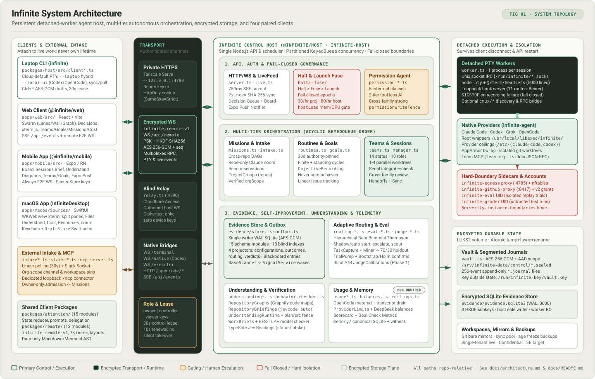
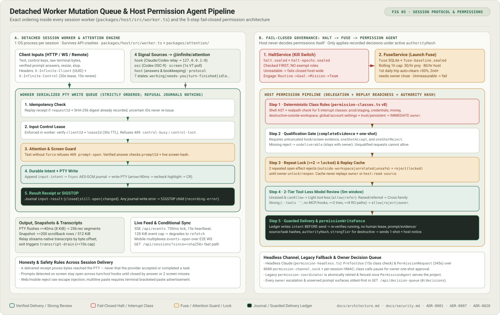
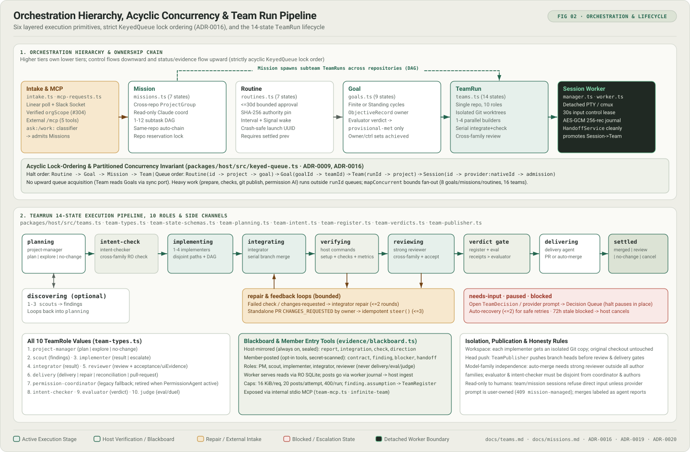
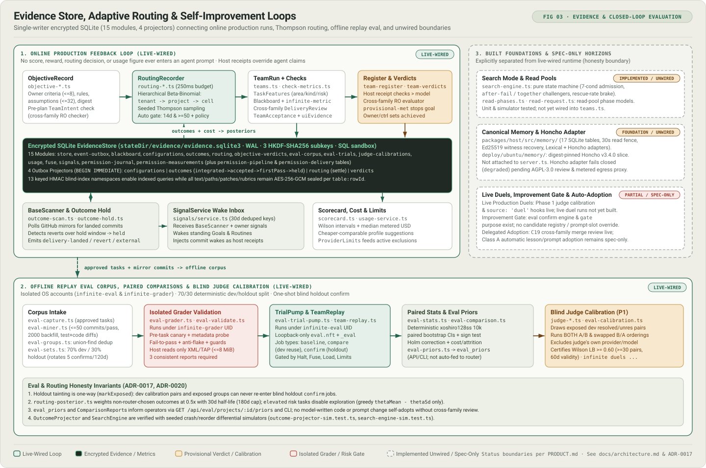
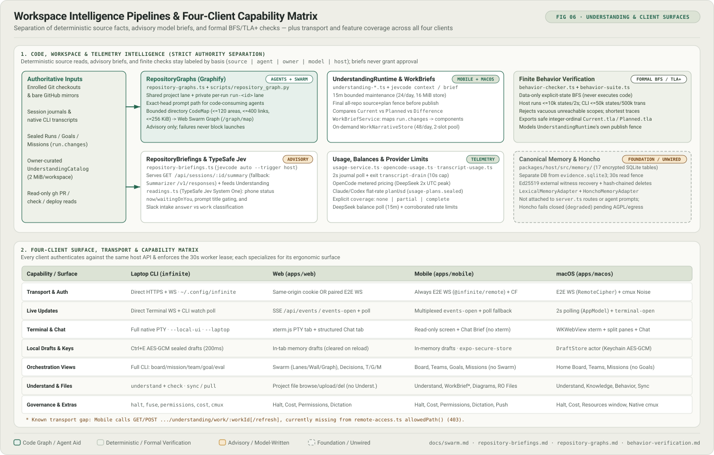
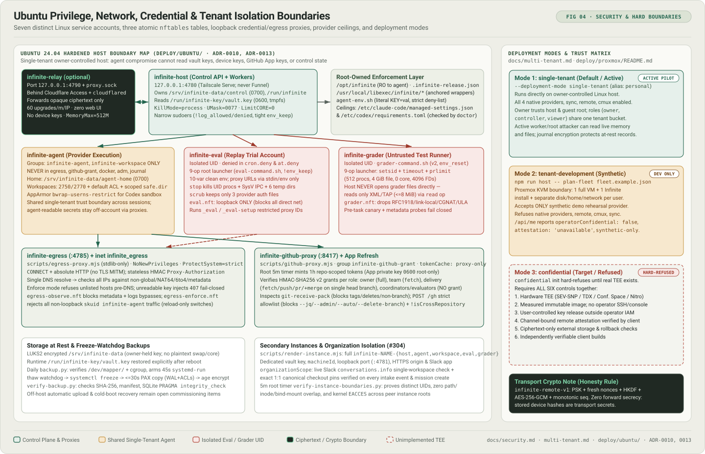

# Infinite System Architecture

This document describes the current Infinite runtime: the implemented single-tenant runner, its multi-tier autonomous orchestration stack, fail-closed governance, encrypted storage and evidence pipelines, workspace intelligence, client surfaces, concurrency invariants, and Ubuntu hard-isolation boundaries.

For managed multi-tenant operator confidentiality, hardware limits, and release gates, see [managed tenants](multi-tenant.md). For task-oriented navigation and a file-level lookup index, see [docs/README.md](README.md).

---

## System Overview and Monorepo Map

Infinite separates agent execution lifetime from API and client lifetimes. Native provider CLIs (`claude`, `codex`, `grok`, `opencode`, plus the synthetic `demo` rehearsal provider) execute inside detached worker processes owned by the host machine, never inside a browser tab, mobile app, or SSH shell. Clients (the laptop CLI, React web app, Expo phone app, and SwiftUI macOS app) attach to the same running processes over authenticated loopback HTTPS or the `infinite-remote-v1` application-encrypted WebSocket channel.

| Workspace / Directory | Role | Key Entry Points |
| --- | --- | --- |
| `packages/attention/` (`@infinite/attention`) | Pure attention state machine, terminal prompt detection, spinner-immune screen activity, hook payload mappers, destructive-command detector, one-shot delegation gate (16 modules) | `src/attention.ts`, `src/prompts.ts`, `src/screen-activity.ts`, `src/delegation.ts`, `src/destructive.ts` |
| `packages/remote/` (`@infinite/remote`) | `infinite-remote-v1` E2E encrypted WS channel, `?since=` list sync, data-only Markdown/Mermaid/diagram layouts, Understanding and Memory wire schemas (13 modules) | `src/protocol.ts`, `src/index.ts`, `src/mermaid.ts`, `src/memory.ts` |
| `packages/host/` (`@infinite/host`) | Control API, detached PTY workers, vault and journals, encrypted SQLite `EvidenceStore`, orchestration services, permission agent, routing, eval, understanding, usage, laptop CLI, blind relay | `src/server.ts`, `src/worker.ts`, `src/manager.ts`, `src/teams.ts`, `src/missions.ts`, `src/goals.ts`, `src/evidence/store.ts` |
| `apps/web/` (`@infinite/web`) | Read-only Swarm dashboard (Lanes/Wall/Graph, with wait pills and spinner-only flags), Decision Queue, xterm.js terminal, Sessions, Teams + Blackboard Inspector (outcome groups, wait reasons, spinner-only indicators), Goals, Missions + Progress Inspector, Cost, Permissions, Halt, Dictation | `src/main.tsx`, `src/swarm/SwarmView.tsx`, `src/team-inspector/`, `src/mission-inspector/`, `src/decision-queue.tsx`, `src/api.ts` |
| `apps/mobile/` (`@infinite/mobile`) | Expo / React Native client (fixed light theme): Board, Sessions Brief, Understand and native SVG diagrams, Teams + Evidence Sheet & outcome groups (wait reasons, spinner-only indicators), Goals, Missions + Progress Inspector, Cost, Permissions, Expo Push | `src/api/client.ts`, `src/features/board/`, `src/features/teams/`, `src/features/understanding/` |
| `apps/macos/` (`InfiniteDesktop`) | SwiftUI + CryptoKit desktop client: WKWebView xterm, split panes, Keychain-sealed `DraftStore` actor, Files and Sync, Understand, Cost, Resources, native cmux client | `Sources/InfiniteCore/`, `Sources/InfiniteDesktop/` |
| `deploy/ubuntu/` & `deploy/proxmox/` | Seven-account Ubuntu 24.04 hardening, `nftables` firewalls, egress and GitHub proxies, ceilings, freeze-watchdog `age` backups, secondary instances, synthetic Proxmox fleet planner | `deploy/ubuntu/README.md`, `deploy/ubuntu/instances.md`, `deploy/proxmox/README.md` |
| `scripts/`, `tests/`, `verification/` | Zero-dependency proxy daemons, Graphify builder, comment and file-size ratchets, discovered `tests/*.test.ts` suites (including seeded simulators and compile-time type tests), formal BFS/TLA+ models | `scripts/egress-proxy.mjs`, `scripts/github-proxy.mjs`, `scripts/run-tests.mjs` |

### Honesty and Authority Rules

Every subsystem enforces four invariants from [PRODUCT.md](../PRODUCT.md):

1. **Receipts over inference.** A delivered receipt proves bytes reached the PTY, never that a provider accepted or completed a task. An idle terminal or exited process never implies completion.
2. **Human authority on outcomes.** Independent evaluator verdicts are labeled as provisional agent assessments. Only an explicit human outcome recorded via `POST /api/goals/:id/outcome` (which admits `owner` and `controller` roles after active work stops, distinct from owner-only administrative credentials) sets a product goal's status to `achieved`.
3. **Unreachable is never exited.** Workers that stop answering report `unavailable` with their last recorded timestamps, never `exited` or `completed`.
4. **Prompt isolation from scoring.** No outcome score, reward, routing decision, evaluation result, spend fuse counter, or usage figure enters an agent prompt.

---

## Session Runtime, Transport and Continuity Protocol

### Detached Worker Lifecycle and Vault Storage

Each session spawns one detached `packages/host/src/worker.ts` daemon owning a `node-pty` terminal (`120×32` default) and an `@xterm/headless` screen emulator (5,000-line scrollback). The API server (`packages/host/src/server.ts`) talks to workers exclusively over private Unix domain sockets (`<socketDir or runDir>/<sessionId>.sock`, mode `0600`, path ≤100 bytes, with configurable `socketDir` and lock-free per-host socket namespacing) using single-request NDJSON frames (`packages/host/src/ipc.ts`, timeouts: 4 s default, 12 s `answer`, 300 s `workspace-export`). Restarting or crashing the HTTP server leaves workers untouched; on startup, `Manager` rediscovers live workers via their sockets and sealed metadata.

Session metadata and journals are encrypted by `packages/host/src/vault.ts`:

- **Master key:** 32 random bytes (`0600`) stored outside `stateDir` (on Ubuntu: `/run/infinite-key/vault.key`, restored explicitly after host reboot).
- **Record sealing:** AES-256-GCM with fresh 96-bit nonces and scope-bound AAD (`infinite:v1:<scope>`). Every file write uses `O_CREAT|O_EXCL` temp file (`0600`) -> `fsync` -> atomic `renameSync` -> parent directory `fsync`.
- **Segmented journals and side indexes:** Append-only 256-record segments (`0000000000.journal`, mode `0600`, AAD `<sessionId>:<seq>`, `fsync` per append; output events are written and synced together by the flush that carries them, so they are durable when that flush returns and every other event is durable when its append returns), paired with a segmented encrypted signal index for `O(signals)` `ContextTouches` and signal-only reads plus a durable PTY-dimension size index so replay frames carry authoritative server dimensions. Workers buffer PTY output for at most 40 ms (8 KiB chunks). At provider terminal close, `pty-tail.ts` drains the PTY descriptor to EOF (up to 1 MiB) before exit and records `outputTailIncomplete: true` if full closure cannot be confirmed. Any journal write error latches `recording-error` and sends `SIGSTOP` to the child process rather than continuing unrecorded. After a failed write or sync, the session's journal takes no more events and ends at the failure, so a later recovery of the disk cannot repeat or skip a sequence number.
- **Session states:** `starting -> running -> exited`, plus fault states `unavailable` (socket unreachable) and `recording-error`.

Host power loss or worker crash leaves the recording intact without silently restarting the process. An owner can explicitly resume a confirmed `exited` session with a known native conversation ID (`POST /api/sessions/:id/resume`), creating a fresh runtime UUID without resending the initial prompt. Fresh launches refuse provider resume flags (`assertFreshNativeContext` in `packages/host/src/context-continuation.ts`) so recordings never silently splice into an unrecorded conversation.

### Serialized Worker Write Queue and Input Control Leases

Input control is enforced inside the worker so API restarts cannot erase ownership (`CONTROL_TTL_MS = 30_000`, clients renew every 10 s). Clients identify each instance with `X-Infinite-Client` (UUID) and hold a server-bound lease ID in `X-Infinite-Control`; knowing another client's lease ID grants no authority. Explicit takeover rotates the lease ID.

Every PTY-touching worker request (`input`, `raw`, `key`, `stop`, `answer`, `team-answer`, `team-permission-expand`, `session-permission-answer`, and `resize`) runs through the worker's single serialized queue (`serialize()`) so queued worker requests never interleave with one another. PTY output (`child.onData`) flows through `terminalBarrier.dispatch()` rather than `serialize()`, so output continues during async operations such as `answer()` screen polls and is deferred only while an active terminal barrier runs (for example during `resize` or `snapshot`). Within `serialize()`, the idempotent delivery receipt protocol applies to input, stop, expand, and answer deliveries (`input`, `raw`, `key`, `stop`, `answer`, `team-answer`, `team-permission-expand`, `session-permission-answer`) in strict order:

1. **Idempotency (`requestId`):** If `requestId` + SHA-256 request digest is already recorded, replay its receipt. Ambiguous writes remain `uncertain` and are never silently reissued under a new ID.
2. **Control lease check:** Verify `clientId` + `leaseId`. Stale or competing writers receive `409 { code: "control-busy" | "control-lost" }`.
3. **Attention and screen guard:** Text without `force: true` refuses `409 { error: "prompt-open", attention }` while an on-screen dialog is active. Verified answers check `promptId` and recompute the live screen hash.
4. **Durable intent and PTY write:** Append `input-intent` and `fsync`, then write to the PTY.
5. **Result receipt:** Append `input-result` (`delivered`, or `closed | still-open | changed` for verified answers). A refusal at steps 1–3 journals nothing.

`resize` shares the same serialized queue and control-lease check, updates `@xterm/headless` and the PTY behind a terminal barrier, appends a `lifecycle` `resize` event (and size-index entry) only when dimensions actually change, refreshes the lease, and returns `{ ok: true }`. If the barrier refuses the resize at drain (>2 MiB output queue full or 1 s renderer drain deadline), the refusal callback restores the PTY back to the terminal's applied size and throws `Refusal("resize-refused", ...)` (`packages/host/src/worker.ts`). Over `POST /api/sessions/:id/resize` (`packages/host/src/server.ts`), the host answers HTTP `503 { code: "resize-refused", error }`; over the duplex WebSocket (`packages/host/src/terminal-stream.ts`), it sends a separate `resizeRefusal` frame and keeps the socket open without revoking the client's control lease. The laptop CLI (`packages/host/src/client.ts`, `packages/host/src/client-transport.ts`) retries on `resizeRefusal` (and on failed legacy HTTP resize calls) after `250`, `500`, and `1000 ms`, cancelling any pending retry when a newer local resize arrives, and stops after those three retries; macOS client resize retry is tracked separately. `resize` does not accept or deduplicate a `requestId` and does not journal `input-intent` or `input-result`.

Terminal-native clients (owner-only WebSocket/SSH/IPC) may send raw terminal sequences and send text with `force: true`. Web and mobile reject escape/control injection and allow multiline paste only when the terminal advertises bracketed paste.

### Signals, Attention and Verified Answers

`packages/attention/` reduces four labeled signal sources (`hook`, `osc`, `screen`, `host`, plus `protocol` for cmux/native adapters) into seven attention states: `working`, `needs-you`, `turn-finished`, `idle`, `exited`, `unavailable`, and `recording-error` ([ADR-0001](adr/0001-attention-prompt-lifecycle-and-screen-authority.md)).

- **Per-worker hook server (`packages/host/src/hooks.ts`):** Binds `127.0.0.1:0` with a 32-byte random Bearer token (256 KiB cap) serving 11 routes: `/claude`, `/codex`, `/codex-notify`, `/team-report`, `/mission-report`, `/team-handoff`, `/transcript`, `/drain`, `/team-entry`, `/permission-check`, `/permission-request`. Codex hooks stay off by default because enabling them allows untrusted repository Codex hooks to run (`docs/security.md`).
- **Screen authority and single-close invariant:** Every journaled `prompt-open` closes exactly once. Prompts detected on screen (`prompts.ts`: Code Mode confirmation, numbered option lists, workspace trust, `[y/N]`) survive turn/tool hooks until answered or absent across two consecutive 1 s screen polls. Hook prompts merge into on-screen dialogs only when lines correlate (`correlates()`), journaling `prompt-merged` or `prompt-mismatch`.
- **Verified answer protocol (`POST /api/sessions/:id/answer`):** Re-parses the live `@xterm/headless` screen, checks `prompt.hash`, steps arrow keys at 40 ms intervals, polls up to 500 ms to confirm the highlight landed on the chosen option (aborting with `changed` before pressing Enter if the dialog shifted), sends `\r`, and polls up to 1,500 ms to report `closed` or `still-open`. Hooks never approve anything.

### Chat from the provider's own record

Command hooks run Infinite's relay inside the agent account (`packages/host/src/transcript.ts`, `transcript-watch.ts`). The relay streams new JSONL bytes from the provider's native transcript file by byte offset to `/transcript`, keeping the agent's home private to `infinite-agent`. Complete records become deduplicated `message` journal events (dropping injected context, subagent chat, and reasoning; Claude subagent usage is tracked separately). On exit, `final-drain.ts` runs the root-owned `transcript-drain` wrapper (10 s cap) so trailing messages and usage settle. Once a session has transcript messages (`capabilities.transcript = 1`), `GET /api/sessions/:id/messages` serves `source: "transcript"`; otherwise it serves recorded user prompts and hook replies (`source: "recording"`) without fabricating assistant text from terminal bytes.

- **Session summaries (`GET /api/sessions/:id/summary?after=`):** Served by `RepositoryBriefings` (`jevcode auto --trigger host`) when configured, falling back to `Summarizer` (`/v1/responses`) for plain-text digests cached per cursor range.
- **Dictation cleanup (`POST /api/dictation/cleanup`):** Sends platform speech recognition text to `dictation.model` with `store: false` (25 s timeout). Clients fall back to raw transcripts on error, never auto-send, and stop capture if the field locks.

### Delivery contract

- **Conditional list polling (`GET /api/sessions?since=<version>`):** Returns `{ version, unchanged: true }` when the 22-char base64url SHA-256 digest of serialized rows matches. Unreachable workers carry recorded timestamps so unchanged lists retain their digest.
- **SSE Live Feed (`GET /api/events?topics=...&after=...`, `packages/host/src/live.ts`):** One host loop ticks every 750 ms only while subscribers exist. Shares state and journal reads across equal cursors (max 32 journal page reads/tick, 4 concurrent), caps 4 streams per credential, sends 15 s heartbeats, and degrades topics exceeding 128 KiB UTF-8 JSON to `refetch` notices.
- **Direct Terminal WebSocket (`WS /api/sessions/:id/terminal`):** Owner-only writes, 10 s auth, optional VT snapshot (`snapshot=1`, ≤200 scrollback rows / 512 KiB) followed by `fs.watch`-driven sequence deltas, 15 s ping/pong, a bounded 256 KiB / 128-frame input queue, and separate `resizeRefusal` frames (`packages/host/src/terminal-stream.ts`) that keep the socket and control lease open when the worker raises `resize-refused`.
- **Application-Encrypted Remote Channel (`infinite-remote-v1`, `packages/remote/src/protocol.ts`, `packages/host/src/remote-access.ts`, [ADR-0002](adr/0002-remote-encrypted-channel-and-sync-contracts.md)):** Connects directly to `WS /api/remote` or through the blind `infinite-relay` (`packages/host/src/relay.ts`, `:4790`, outbound host WS `/relay/hosts/:machineId`, optional Cloudflare Access).
  - *Handshake:* Pre-shared device key (`key = SHA-256(token)`) authenticates `hello`/`welcome` 32-byte nonces via HMAC-SHA256; `HKDF-SHA256(ikm=key, salt=SHA-256(transcript), info="infinite-remote-v1:directional-keys")` derives separate 32-byte `clientKey` and `serverKey`; frames encrypt with AES-256-GCM using monotonic `seq` nonces (`0x00000000 || uint64_be(seq)`) and transcript-bound AAD. There is no forward secrecy; stored device key hashes are transport secrets.
  - *Multiplexing:* Carries HTTP RPC (`request`/`response`, 96 KiB req / 4 MiB resp, 8 pending/channel), terminal streams (`terminal-open`, max 4/channel), and live event streams (`events-open`, max 4/channel) inside one explicit `allowedPath()` allowlist. Oversized `GET /api/teams` responses fall back to `view=list` for 5 minutes.
- **Workspace Sync vs GitHub Mirrors:** Exclusive per project (`docs/workspace-sync.md`). `sync` uploads changed files from a laptop checkout in batched 256 KiB content-addressed chunks (`PUT /api/projects/:id/sync/blobs`, ≤2 MiB / 512 chunks per request) into a shared content pool and atomically swaps when idle. Upload routes require `X-Infinite-Sync-Publisher` (UUID) on `begin` and both `X-Infinite-Sync-Publisher` and `X-Infinite-Sync-Generation` on `has`, chunk uploads, and `commit` (`400 invalid-sync-headers` when missing or malformed); `repo init` one-time source captures fence upload receipts and active leases via `source-upload-receipt.ts`. Automatic shared workspace blob pool garbage collection (`packages/host/src/workspace-pool-gc.ts`, `workspace-pool-leases.ts`, `workspace-pool-scopes.ts`) prunes superseded project-sync and hybrid-session scope references and reclaims unreferenced pool chunks after a safety grace window once active read/write leases and legacy writers settle (legacy store-local chunks, Git mirrors, and mutable workspace copies remain operator-managed). `github` projects maintain a host-private bare mirror and fast-forward the project directory when idle and before team runs.
- **Hybrid `--laptop`, `--local-ui` Bridges and Codex Environment Fencing (`packages/host/src/native-bridge.ts`, `executor-tunnel.ts`, `hybrid-workspace.ts`, `codex-environment*.ts`, `native-codex.ts`, `deadline.ts`):** Codex `--laptop` keeps tools on the laptop while streaming incremental checkpoints (`sync/*`); losing the laptop for >5 s hands execution over to the prepared cloud tree (`docs/hybrid-execution.md`). Codex execution environment placements persist in AES-256-GCM sealed `codex-environments.sealed` (`codex-environment-store.ts`, `0600`, ≤2 MiB verified before atomic swap) and tool dispatch passes through a loopback `CodexToolFence` proxy (`codex-environment-fence.ts`) that blocks unverified, selecting, uncertain, superseded, or post-restart-unverified placements, confines startup/resume discovery to root-contained read-only `fs/getMetadata`/`fs/readFile` (with symlink checks), tags queued pre-handshake frames with authorization generation, and restores saved threads (`thread/resume` + `thread/read` verification) across provider restarts in `native-codex.ts` and `worker.ts`, failing closed on drift or corruption. Experimental `--local-ui` proxies local Codex (`WS /api/sessions/:id/native`, 64 KiB binary catalog chunks) and OpenCode (`ALL /api/sessions/:id/opencode/*`) UIs to host-managed backends under the worker's control lease (`docs/native-continuity.md`). Shared `replyDeadline` (`deadline.ts`) defers timeout callbacks one `setImmediate` turn past the timer (15 s native HTTP proxy, Codex environment calls, and workspace-watch barriers; 20 s native catalog chunk acks; CLI terminal input/control acks) and rechecks pending state so replies arriving during an event-loop stall are not discarded.
- **cmux Backend (`packages/host/src/cmux/`):** Discovers existing Claude/Codex sessions via `cmux rpc`, verifies foreground processes via `ps`, maps prompts into Infinite's session model, and enforces a 30 s control lease (`docs/remote-machines.md`).

---

## Orchestration Stack and State Machines

Infinite layers five durable coordination primitives above detached session workers. Every service stores AES-256-GCM `.sealed` state files, enforces optimistic concurrency (`revision`), and deduplicates mutations by `requestId` + payload fingerprint.

### Hierarchy and Ownership

| Layer | Module and States | Scope and Invariants |
| --- | --- | --- |
| Intake and External MCP | `intake.ts`, `mcp-requests.ts` (`queued`, `started`, `finished`, `skipped`) | Polls Linear (30 s) + Slack Socket Mode + dedicated loopback `/mcp` (5 tools). Admits owner-only requests as Missions; `ask:`/`work:` prefix or Jev classifier routes questions to `mode: "answer"` (≤30 min, zero subteams). Outbound text scrubs local paths and IPv4s. |
| Mission | `missions.ts`, 7 states (`planning`, `working`, `needs-input`, `paused`, `blocked`, `ready-for-review`, `cancelled`) | Coordinates a cross-repository `ProjectGroup` via a read-only Claude Code coordinator running outside every repo (Claude-only across schemas, intake config validation, and launch; existing saved missions stay inspectable if `teams.lineup.coordinator` switches away from Claude; `dontAsk`, Read/Glob/Grep + `mission_report` MCP; max 60 attempts, 10 report kinds, conversation rotation on idle/tokens/age). Dispatches 1–12 subtask `TeamRun`s, auto-chains same-repo subtasks sequentially, and reserves active repositories. Intake missions freeze working clocks while `needs-input` or `paused`. |
| Routine | `routines.ts`, 7 states (`scheduled`, `running`, `paused`, `blocked`, `completed`, `cancelled`, `expired`) | Bounded recurring approval (≤30 days, 1–100 occurrences, 5–10,080 min interval, max 1,000 retained). Pins a SHA-256 `authority` digest over project path, policies, source, Linear, and agents; any drift blocks the routine. Checks that the prior goal `safelySettled` before launching the next occurrence using a crash-safe pre-persisted `launch.requestId`. |
| Goal | `goals.ts`, `goal-released-run.ts`, `goal-waiting-control.ts`, 9 states (`running`, `needs-input`, `paused`; terminal: `blocked`, `ready-for-review`, `no-opportunity`, `limit-reached`, `cancelled`, `achieved`) | Runs sequential single-repo `TeamRun` cycles from reviewed/merged commits. Finite goals bound `maxRuns` (1–10), `maxMinutes`, and `maxMembers`. Standing objectives require `autonomy === "autonomous"` and a cross-family evaluator, run on cadence or `SignalService` wakes, keep 50 detailed cycles (folding older totals), and auto-pause on supervised switch or 3 consecutive failed/no-progress cycles. Never auto-sets `achieved`. Leftover `blocked`/`paused` runs of a stopped goal (with no queued control, pending extension, or deadline-extendable cycle) cancel directly via `POST /api/teams/:id/cancel` through `GoalService.cancelReleasedRun` under the `goalId -> teamId` lock order so the cycle records `cancelled` and cleanup reaps the run record. When a goal's `resume` or `steer` meets `409 team-command-running` on a stop-fenced team run, `goal-waiting-control.ts` holds the waiting control and retries with 30 s census reuse; an owner `pause`, `cancel`, or `halt` supersedes a waiting control (keeping a superseded steer in the goal's steering). |
| TeamRun | `teams.ts`, `team-consumer.ts` (`TeamConsumer`), `team-publisher.ts`, `team-recovery.ts`, `team-retention.ts`, `team-prompt-sections.ts`, `team-command-fence.ts`, `team-leftover.ts`, 14 states (10 active + 4 settled: `ready-for-review`, `merged`, `no-change`, `cancelled`) | Single-repo multi-role run across 10 roles: `project-manager`, `scout`, `implementer` (1–4 parallel isolated Git worktrees with disjoint paths and topological DAG validation), `integrator` (serial merge + ≤2 repair rounds), `reviewer` (strong cross-family + acceptance/UI evidence check), `delivery` (PR or auto-merge on exact reviewed commit), `permission-coordinator` (legacy fallback), `intent-checker`, `evaluator`, and `judge`. `TeamConsumer` (`team-consumer.ts`) owns member report consumption and verification check execution/orchestration alongside `team-publisher.ts`, `team-recovery.ts`, and `team-retention.ts`. Structured prompt sections persist on the sealed `Stored` envelope (`Stored.memberPromptSections`, bound by `sha256(member.prompt)`, kept off `TeamView` for rollback privacy) and render provider-specific blocks deterministically on launch and provider-limit retarget within the 80 KiB prompt cap. Prefixed project/member setup, check, and main-check commands run behind a shell anchor (`group-supervisor.ts` `teamAnchored`) so stops signal the whole process group and follow with `SIGKILL` after grace; stopped prefixed or open-pipe setup/check commands fail with `command-stop-unconfirmed` and stay fenced (`team-command-fence.ts`, `409 team-command-running`) until a two-pass process census (`process-census.ts`) finds no live processes or, when the census reports `unknown`, the owner attests via `POST /api/teams/:id/processes-ended` (`infinite team processes-ended TEAM_ID`, off the remote relay allowlist). Leader-exit open-pipe drains and post-operation settle looks (`liveWitness`) record surviving processes in `team-leftover.ts` (`leftoverProcesses` on the team view), holding run directories against retention and owner deletion (`409 team-leftover-running` / `team-leftover-unknown`) until cleared (`docs/teams.md`). Stall detection filters spinner-only screen churn (`screen-activity.ts`, `worker-screen-activity.ts`, `stall-recovery.ts`) and projects host-derived `waitReasons` (`team-wait-reasons.ts`). |
| Handoff | `handoffs.ts` (`available`, `unavailable`, `requested`, `waiting-for-control`, `started`, `blocked`) | Cleanly transfers an interactive session into a `TeamRun` after reserving the project and detaching client control. |

### Projects over Checkouts, Contexts and Verified Organization Scope

- **Immutable Checkout Identity (`packages/host/src/checkout-identity.ts`, `project-groups.ts`):** Captured once into `project-groups/identities.sealed` (preferring GitHub source remote -> `origin` URL -> earliest root commit) so agent edits to `.git/config` cannot regroup repositories. Checkouts of one repository fold automatically into a `ProjectGroup`; cross-repo grouping is explicit and never merges `ProjectContext`, Linear mappings, delivery policies, or permission delegations. Moving a project increments `ownerMoveMark`, invalidating active permission delegations.
- **Enrollment-Bound Project Context (`project-context.ts`):** Sealed contexts (≤24 KiB) and directional cross-project links (≤16 links, ≤48 KiB combined) pin both `realpathSync(project.path)` and verified repository enrollment bindings (`local` project/company epochs and GitHub source/delivery repository IDs; when Slack intake is configured, `workspace` bindings matching `organizationScope.workspaces`). Cross-project links must stay within the enrolled workspace audience (`403` when missing or outside the audience). Any root, repository, or enrollment drift sets `binding: "review-required"` and blocks launches (`409`).
- **Verified Organization Intake (`intake-audience.ts`, `slack-client.ts`, `intake.ts`):** Every Slack installation requires a nonempty `organizationScope.workspaces` pin list and has no unscoped mode. Slack events, interactions, thread reads, replies, and queued filing/mission starts re-verify live via `conversations.info` that the channel is an allowed single-workspace non-shared channel (`is_shared=false`, `shared_team_ids=[teamId]`, `is_member=true`) and that `intake.mission.groupId` matches the exact 1:1 canonical `realpath` and Git remote / root-commit pins; immutable audience digests keep old or changed records inert. Hosts without Slack keep Linear-only intake, and `GET /api/intake/workspace-scope` reports `unconfigured`.

### Blackboard, Internal MCP and Board Aggregation

- **Blackboard (`evidence/blackboard.ts`, `team-entry-*.ts`):** Host automatically mirrors `report`, `integration`, `check`, and `direction` entries (sealed; never auto-injected into prompts). When `config.teams.blackboard.tools` is enabled at run creation, eligible roles (`project-manager`, `scout`, `implementer`, `integrator`, `reviewer`) receive `entry_post`, `entry_list`, and `entry_get` through the internal stdio MCP server (`packages/host/src/team-mcp.ts`, server `infinite-team`, schemas verified via `Exact<A, B>` in `team-mcp-results.ts`) or stdin fallback. Workers serve reads from a read-only SQLite connection and journal posts as `team-entry` events that the host secret-scans (`evidence/secret-scan.ts`) and ingests (caps: 16 KiB/req, 20 posts/attempt, 400/run).
- **Board (`GET /api/board`, `missions.ts`):** Groups missions plus standalone teams and goals into four columns (`needs-input`, `working`, `review`, `ended`). Running items with a user-owned provider prompt (`waitsOnProvider` / `promptedSubtask`) surface in `needs-input`. Repeated identical objectives group into `BoardAttempt`s.

---

## Fail-Closed Governance: Halt, Fuse and Host Permission Agent

Refer to the right panel of [FIG 05](diagrams/session-protocol-and-permissions.svg). Every automatic launch and permission review passes through a three-layer fail-closed stack:

1. **Autonomous-Work Halt (`packages/host/src/halt/service.ts`):** Checked ahead of `FuseService` across autonomous and team launches (`routines`, `goals`, `missions`, `teams`, `Manager.createTeamSession` for `request.team` launches, `EvalHost`, `MainCheckService`) and permission review/delivery, with zero exempt autonomous roles. Writes `halt-epochs.sealed` before `halt.sealed` so restoring an older halt file cannot revert permission-invalidating epochs. Unreadable files fail closed for those gated autonomous launches host-wide (`409 halt-unreadable`). `POST /api/halt` pauses autonomous work via `pauseWithPendingCreates` in deterministic order (`routines -> goals -> missions -> teams`, pausing `needs-input` runs in place); `POST /api/halt/release` resumes in reverse order. Ordinary owner-started interactive sessions keep running and can still start during a halt.
2. **Launch-Rate Fuse (`packages/host/src/fuse/service.ts`):** Rolling 1-hour launch caps across fuse-gated autonomous launches (`routines`, `goals`, `missions`, `teams`, and `Manager.createTeamSession`; default `30/hr` per project, `80/hr` host-wide). `FuseService.admit()` explicitly exempts `permission-coordinator`, and `MainCheckService` checks halt and `hostLoad` directly rather than the fuse. First daily trip auto-closes below 50% rolling count; second same-day trip requires `POST /api/fuse/close`. An unreadable baseline fails closed for non-exempt fuse-gated launches (`cause: "unmeasurable"`). Optional `hostLoad` (`docs/hosting.md`) holds automatic launches when Linux `MemAvailable` or 1-minute load per CPU crosses configured bounds.
3. **Host Permission Pipeline (`packages/host/src/permission-*.ts`):** Active only when the workspace is explicitly delegated (`PermissionDelegationService` matching `realpath` and `ownerMoveMark`) and `PermissionAgentCore` passes replay readiness (tool-less light profile, strong profiles from ≥2 model families, replay Wilson upper miss-rate bound within cap for the current `bindingDigest`). Any delegation, policy, rule, profile, or halt-epoch change rotates `authorityHash` and invalidates in-flight reviews immediately:
   - **Step 1 (Class rules v8):** Deterministic shell AST + realpath check catches 5 `INTERRUPT_CLASSES` (`production-or-staging`, `credentials`, `money`, `destructive-outside-workspace`, `global-or-account-settings`), trust prompts, and persistent-only dialogs -> immediate `owner` escalation.
   - **Step 2 (Qualification):** Requires untruncated hook/screen evidence, `oneShotAccept`, and `oneShotReject`.
   - **Step 3 (Repeat lock and replay):** Two repeated open effect rejects (`outside-workspace | unrelated | unsafe`) lock the assignment (`reject(locked)`) until owner `unlock` / `reopen`. Replay cache never replays `owner` or `host:read-source` allows.
   - **Step 4 (2-tier tool-less AI review):** Unraised allowed requests try a tool-less light model (`allow | refer`); raised or referred requests go to a strictly cross-family strong model (`--safe-mode --tools "" --strict-mcp-config --setting-sources ""`, zero hooks, ≤2 attempts, ≤8 read-only file paths once, aborting Git evidence reads when the team halts). Host rejects invalid verdicts fail-closed as `unavailable`.
   - **Step 5 (Guarded delivery and write fence):** `EvidenceDeliveryLedger` records `intent` before sending; re-verifies session liveness, absence of human control lease, prompt/evidence/source/task hashes, `authorityHash`, and `strongTier` for destructive accepts; sends one-shot keystroke + fixed host `requesterNotice(code)`. Express middleware (`permissionWriteFence`) holds revocation/halt HTTP responses until in-flight deliveries are fenced. Headless Claude uses `0600` `permission-channel.sock` + per-session HMAC (`PreToolUse` 15 s, `PermissionRequest` 345 s).

Every user-owned session prompt, standalone/goal team decision, and mission decision collects oldest-first into `GET /api/decision-queue` (web `#/decisions`).

---

## Evidence Store, Self-Improvement and Evaluation

### Evidence store

`stateDir/evidence/evidence.sqlite3` (`packages/host/src/evidence/`, mode `0600`, WAL mode, `node:sqlite`) is the unified telemetry and learning store with the host process as sole writer. New databases build under `<file>.creating-<pid>-<uuid>` and publish via atomic `linkSync`.

- **Cryptography (`evidence/crypto.ts`):** Derives three HKDF-SHA-256 subkeys from the host vault key (`row-encryption`, `blind-index`, `event-key`). Plain columns hold only opaque IDs, enums, numbers, timestamps, and 13 domain-separated keyed HMAC-SHA-256 blind indexes; all free text, file paths, patches, rubrics, and payloads live in AES-256-GCM envelopes bound to `infinite:evidence:v1:<table>:<rowId>`.
- **SQL sandbox and soft availability:** `checkedSql` rejects transaction/pragma keywords and Tcl parameters; mutations execute synchronously under `BEGIN IMMEDIATE`. If the store cannot open (key mismatch, full disk, newer module schema), it reports `unavailable` at `GET /api/evidence/status` while sealed run records remain authoritative.
- **15 Registered Modules and 4 Outbox Projectors:** Modules cover `store`, `event-outbox`, `blackboard`, `configurations`, `outcomes` (11 tables), `routing`, `objective-verdicts` (730 d retention), `eval-corpus`, `eval-trials` (7 tables), `judge-calibrations`, `usage`, `fuse`, `signals` (30 d), `permission-journal`, and `permission-measurements` (plus pipeline/delivery tables). `EventOutbox` transactionally advances four synchronous projectors (`configurations`, `outcomes`, `routing`, `verdicts`) off append-only `run_events`.

### Online Verification, Outcomes and Wake Signals

1. **Objective Record and Pre-Plan Intent Check (`objective-*.ts`, `team-intent.ts`):** Goals and standalone teams maintain a digest-sealed `ObjectiveRecord` (≤8 criteria, ≤32 assumptions, ≤8 open questions). When `intentCheck` is `on`, a read-only cross-family `intent-checker` screens the PM's plan before dispatch.
2. **Host Checks, Metrics and Cross-Family Merge Gate (`check-metrics.ts`, `delivery-review.ts`, `team-acceptance.ts`):** Passing check stdout emits `infinite-metric <name> <number>` series (`GET /api/goals/:id/metrics`). Reviewer approval checks `TeamBrief.acceptance` and UI evidence. Automatic merge requires a strong reviewer outside every author model family recorded in `DeliveryReviewLineage`.
3. **Assumption Register and Provisional Verdicts (`team-register.ts`, `team-verdicts.ts`, `verdict-compose.ts`, `goal-verdicts.ts`):** `TeamRegister` verifies blackboard assumption proposals and produces host blob/check receipts. `TeamVerdicts` runs a cross-family read-only `evaluator` (if evaluator working-copy preparation fails, no evaluator member starts and the verdict settles as `inconclusive` with `reason: "evaluator-unavailable"` without blocking the run, while `team-root-unsafe` and other role prep failures still block), then `composeVerdict` enforces host-receipt supremacy (overriding contradicting evaluator claims and invalidating `met` if pinned files changed). `merged` and `landed` criteria initially record `inconclusive` (`before-delivery`) and settle from `OutcomeLedger`/`BaseScanner` landing and revert signals (`merged` becomes `met` once landed; `landed` is `met` while standing and `not-met` after a revert). Autonomous finite goals wait up to 10 minutes for a delivered cycle's landing signal before continuing, stop at `ready-for-review` (`stopReason: "provisional-met"`) if a late receipt makes the cycle `met`, and withdraw the provisional reason if a revert turns it `not-met`.
4. **Outcome Ledger, `BaseScanner` and `SignalService` (`outcome-*.ts`, `signals/`):** `outcomeProjector` computes four hierarchical levels per attempt (`integrated -> accepted -> firstPass -> held`) with round attribution and exclusion flags. `BaseScanner` polls GitHub mirrors to confirm landed commits and detect reverts over hold windows, updating `held` and emitting deduplicated signals (`delivery-landed`, `revert`, `external-commit`) into `SignalService` to wake standing goals and routines. `scorecard.ts` serves Wilson intervals, median metered USD, and cheaper-comparable profile suggestions at `GET /api/usage/models`.

### Adaptive Model Routing (Thompson Sampling)

`packages/host/src/routing-*.ts` (15 modules) selects profiles at `start`, `escalation`, and `scout` points within a 250 ms budget:

- **Featurization (`task-features.ts`):** Maps owned paths to `FeatureMap` areas, task `kind`, and `risk: "normal" | "elevated"` (path prefixes + 28 security/infra tokens).
- **Hierarchical Beta-Binomial Posterior (`routing-posterior.ts`):** Shrinks `tenant -> project -> cell` (`LEVEL_STRENGTH = 20`, `EARLIER_MASS = 10`, 30-day half-life, 180-day cap, `0.5×` weight on non-router-chosen outcomes) over reward `theta` and first-pass rate `phi` using `production` and `duel` outcome rows.
- **Cost-Aware Thompson Sampling (`routing-sample.ts`, `routing-choice.ts`, `routing-headroom.ts`, `routing-guards.ts`):** Seeded SHA-256 + Marsaglia-Tsang Beta draws maximize `value * theta - listWeight * (costUsd + (1 - phi) * rescueUsd) - value * headroomWeight * pressure`. `costUsd` prefers observed complete `listUsd` persisted on outcome rows (pooled hierarchically `cell -> project -> tenant` with ≥5 complete-cost attempts and 30-day half-life decay) and falls back to `TIER_COSTS` defaults when unavailable. Provider limit headroom `h` derives from `ProviderLimits` 30-day usage-limit history and `usage_records` (5-hour short and 7-day long trailing windows, falling back to token counts when any record in a window is unpriced), applying linear `pressure` below `h = 0.5` and blocking exploration (`greedy-headroom`) below `h = 0.2`. `elevated` risk tasks disable exploration (greedy `thetaMean - thetaSd` with 3× value weight). Exploration also halts when paused, spare attempts are low, or rolling `maxExploreShare` is reached. The shadow-period gate ends at the later of 14 days after a project's first recorded start decision and its 50th recorded start decision; switching to automatic routing requires the project's routing policy to be configured as `auto` (or left unset in `autonomous` autonomy mode, subject to an eligible implementer profile)—an explicit `shadow` policy stays in shadow, and eligible `auto` takes effect on new runs.

### Offline Replay Eval Corpus and Blind Judge Calibration

`EvalHost` (`packages/host/src/eval-*.ts`) builds a continuous private benchmark directly from repository work:

- **Capture and Mining:** `TaskCapture` extracts approved production tasks (excluding same-model reviews); `Miner` scans up to 50 base-branch commits/pass (2,000 backfill) for commits with code + test diffs. `GroupPass` deduplicates overlapping lineages via union-find; `eval-sets.ts` splits 70% `dev` / 30% `holdout` via keyed blind index with one-way `markExposed` tainting and rotation every 5 confirms or 120 days.
- **Isolated Validation (`eval-grader.ts`, `eval-validate.ts`):** Runs fail-to-pass, anti-flake, and guard checks under the dedicated `infinite-grader` UID with pre-task canary probes, accepting only 3 consistent JUnit XML/TAP reports (≤8 MiB).
- **Isolated Trials, Spend/Fuse Budgets and Paired Statistics (`eval-budget.ts`, `eval-config.ts`, `eval-trial-jobs.ts`, `eval-trial-pump.ts`, `eval-stats.ts`, `eval-priors.ts`):** `TrialPump` executes `baseline`, `compare` (dev, reuse allowed), and one-shot blind `confirm` (holdout) runs via `TeamReplay` under `infinite-eval` (`eval.nft` loopback-only). Trial job creation checks the spend fuse (`FuseService`) and fail-closed provider USD budgets (`eval.providerBudgets` and host `usage.budgets` across UTC `day`/`week`/`month` periods via `UsageService`) whenever new trials are required (refusing creation with `409 spend-fuse-open`, `provider-budget-exceeded`, or `provider-budget-unmeasurable`; a comparison that reuses every trial skips the creation-time spend check, and active `ProviderLimits` do not reject creation). Scheduling and launch rechecks enforce all three gates (`FuseService`, provider USD budgets, and `ProviderLimits`), holding active launches on `spend-fuse`, `provider-budget`, `budget-unmeasurable`, or `provider-limit`, with optional `trialsPerDay` retained only as a secondary daily trial-count cap. `ComparisonPass` computes deterministic `xoshiro128ss` 10,000-resample paired bootstrap CIs, exact sign tests, and Holm corrections, and materializes `eval_priors` (`GET /api/eval/projects/:id/priors`, advisory for operators and not auto-fed into `routing-posterior.ts`).
- **Blind Judge Calibration (`judge-*.ts`, `duel-cli.ts`):** Phase 1 of duels draws exposed dev resolved/unresolved trial patch pairs, excludes the judge's own provider/model, runs both A/B and swapped B/A orderings via `TrialPump` over read-only `.git/infinite-judge/` packages under the same `FuseService` (`spend-fuse`), `ProviderLimits`, and fail-closed provider USD budget gates (`provider-budget`, `budget-unmeasurable`), and certifies a judge when 95% Wilson lower bound ≥0.60 over ≥30 pairs (valid 60 days).

### Implemented Unwired and Spec-Only Horizons

- **Search Mode (`packages/host/src/search-engine.ts`):** Pure state machine (7-condition admission, fail-at-base check, `after-fail`/`together` multi-family challengers, widening deadline check ahead of the pending-launch guard so widening past the deadline ends `abandoned` (`deadline`) and cancels any pending arming launch without widening or tripping the brake unless a late receipt reports a started challenger while failing the deadline at arming under `start: "together"` leaves the search `armed`, and rescue-rate brake) verified by `search-engine-sim.test.ts`; not yet wired into `teams.ts`.
- **Read Pools (`read-phases.ts`, `read-request.ts`):** Phase/request data models built and tested; not yet wired into `teams.ts` (`crossing-digest.ts`, including `readStoredCrossingDigest` normalization of persisted digests on read, `goal-digest.ts`, and `context-touches.ts` are live).
- **Execution Identity, Live Duels, Improvement Gate and Class A Auto-Adoption:** Host-owned `executionIdentity: "production" | "eval"` (`types.ts`, `launch.ts`, `manager.ts`, `worker.ts`, `code-mode.ts`, `egress.ts`, `github-grants.ts`, `notifier.ts`, `decision-queue-read.ts`, `team-replay.ts`) is decoupled from `SessionPurpose` (`"work" | "duel" | "replay" | "gate"`): `"replay"` and `"gate"` force `"eval"`, `"work"` forces `"production"`, and `"duel"` requires an explicit identity. `"eval"` selects eval launch profiles, `_eval` egress, GitHub grant suppression, Code Mode suppression, shared-context omission, and exclusion from session lists, notifications, and the decision queue. Phase 1 judge calibration, `source: "duel"` hooks, and `C19` cross-family merge review are shipped; live production duels, prompt-slot candidate registries, and automated lesson/prompt adoption remain spec-only.

---

## Workspace Understanding, Telemetry and Memory

Infinite separates deterministic source extraction, advisory model prose, formal finite-state verification, cost telemetry, and governed memory so advisory artifacts never gain execution authority.

### Code Graphs, Briefings, Understanding and Behavior Checks

- **Repository Graphs (`repository-graphs.ts`, `scripts/repository_graph.py`, [docs/repository-graphs.md](repository-graphs.md)):** Builds Graphify checkpoints in a project `shared` lane and private per-team-run `run-<teamId>` lanes. Injects exact-head graph paths into code-consuming team member prompts (falling back to source inspection on mismatch or failure) and publishes bounded directory `CodeMap`s (≤120 areas, ≤400 links, ≤256 KiB) to `GET /api/projects/:id/graph/map` for the Web Swarm Graph view.
- **Repository Briefings and TypeSafe Jev (`repository-briefings.ts`, `readings.ts`, [docs/repository-briefings.md](repository-briefings.md)):** Drives `jevcode auto --trigger host` on turn-end/exit to produce cited session summaries (`GET /api/sessions/:id/summary`) and retained workspace briefs. `readings.ts` calls TypeSafe Jev System One for three bounded classifications: phone turn-finished `now`/`waitingOnYou` lines, prompt-to-title fallback gating, and Slack/intake `answer` vs `work` routing.
- **Understanding Engine and Work Briefs (`understanding*.ts`):** `UnderstandingRuntime` runs scheduled (15 m, 24/day) deterministic `jevcode context --repo` source/import maps, bounded synthesis on fingerprint changes, and read-only `gh` PR/check/deploy reads, enforcing a final synchronous all-repository source+plan fence before publication. Mission coordinator briefs bind every participating repository in `repoProjectIds` (`understanding-binding.ts`: enrolled path, checkout identity, and pinned `HEAD` map) and invalidate on read whenever any bound repository advances, changes identity, or splits across workspaces. Merges with owner-curated `UnderstandingCatalog` (2 MiB/workspace) to show `Current`, `Planned`, and `Difference`. `WorkBriefService` deterministically maps `run.changes` onto workspace components (`basis: source|agent|owner|model|host`) with optional on-demand narratives (`WorkNarrativeStore`, 2-slot pool, 48/day).
- **Finite Behavior Verification (`behavior-checker.ts`, `behavior-suite.ts`, [docs/behavior-verification.md](behavior-verification.md)):** Data-only explicit-state BFS safety checker (never executes code; host runs ≤10k states/2 s, CLI ≤50k states/500k transitions) that rejects vacuous unreachable scopes, returns shortest counterexamples, and exports integer-ordinal `Current.tla`/`Planned.tla` suites for independent TLC runs. `verification/understanding-refresh/` formally models `UnderstandingRuntime`'s own publication fence.

### Usage, cost accounting and provider limits

`UsageService` (`packages/host/src/usage*.ts`, `price-catalog.ts`, `balances.ts`, `provider-limits.ts`, `context-gauge.ts`) polls session journals every 2 s into the `usage` EvidenceStore module. OpenCode steps are priced metered (configured overrides -> `PRICE_CATALOG` with DeepSeek weekday UTC 2× peak pricing -> provider `reportedCost` -> `unknown`), backed by 15 m DeepSeek `/user/balance` polls. Claude and Codex track subscription tokens via transcript tail + exit `transcript-drain` (10 s) with owner-editable monthly `planUsd` (`usage-plans.sealed`); `ContextGaugeTail` (`context-gauge.ts`) correlates out-of-order Codex `item_completed` and `response_item` records before attributing tool usage. Every rollup reports explicit `coverage` (`none | partial | complete`) rather than hiding unmeasured work as `$0`. `ProviderLimits` tracks corroborated rate-limit observations and feeds active exclusions into routing, evaluators, and eval trials. Baseline repair-loop instrumentation (`repair-metrics.ts`, `GET /api/usage/repair-loops`, `infinite usage repairs`) computes repair resolution latency, priced token/USD medians (excluding unmeasured loops without coercing to `$0`), and cold-replacement/failed-resume denominators across `review`, `check`, and `delivery` repair loops. Interrupted-task trigger metrics (`interrupted-task-metrics.ts`, `GET /api/usage/interrupted-tasks`, `infinite usage interrupted`) register via `registerInterruptedTaskMetricsRoute` ahead of the `/api/usage` usage-ledger availability gate (`server.ts`), read a lightweight `teams.interruptedTaskRuns(filter)` projection rather than cloning full `understandingRecords()`, and depend only on `EvidenceStore` availability (`503 evidence-unavailable`).

### Canonical memory foundation (unwired)

`packages/host/src/memory/` implements a standalone 17-table encrypted SQLite `MemoryStoreService` (separate from `evidence.sqlite3`, 30 s `MemoryReadFence` transport revalidation, 10k/workspace and 100k/host quotas), Ed25519 external-witness revocation recovery (`MemoryRecoveryCoordinator`), `SqliteProjectionLedger`, `LexicalMemoryAdapter`, and a fail-closed `HonchoMemoryAdapter` (`health: "degraded"`). `deploy/ubuntu/memory/` contains an offline digest-pinned Honcho v3.4.0 qualification suite. None of these modules are wired into `server.ts` routes or agent prompts pending AGPL-3.0 review and a metered egress proxy.

---

## Client Surfaces and Transport Matrix

See the bottom panel of [FIG 06](diagrams/understanding-and-clients.svg) for the visual matrix. Client invariants ([ADRs 0004, 0005, 0012, 0014, 0015](adr/README.md)):

- **Freshness and Anti-Jump:** Web and mobile show last successful refresh time, treat stale responses started before backgrounding as ineligible to mark a returning view fresh, wait ~3 seconds before showing offline banners while immediately disabling steering controls, and never silently reclaim a control lease on foreground return.
- **Local Drafts:** Web and mobile retain drafts and uncertain `requestId`s in process/tab memory only (discarded on reload/exit; never synced cross-device). CLI `Ctrl+E` persists per-client HKDF-derived AES-GCM draft files with PID liveness recovery; macOS `DraftStore` actor seals drafts under a device-only Keychain `SymmetricKey`.
- **Run Inspectors and Remote Parity:** Web (`apps/web/src/team-inspector/`, `mission-inspector/`, Swarm `Lanes`/`Wall`), Mobile (`TeamDetail`, `TeamOverviewGroups`, `TeamEvidenceSection`, `MissionProgressSection`, `WorkBriefScreen`), and CLI (`infinite team status`, `infinite team watch`, `infinite team watch --board`, `infinite mission watch`) read the same host blackboard entries, host-ordered `waitReasons`, per-member `spinnerOnlySince` indicators, mission progress cursors, and Understanding work brief endpoints (`GET/POST /api/project-groups/:id/understanding/work/:workId[/refresh]`), all admitted through `packages/host/src/remote-access.ts` `allowedPath()` while preserving Express role enforcement.

---

## Concurrency, Storage and Type Safety

Waves 1–5 eliminated global mutexes, `.lock` crash wedges, `NSLock`/`NSCondition`, and unvalidated state combinations across all workspaces ([ADRs 0003, 0006–0009, 0015–0016, 0019, 0022](adr/README.md)):

- **Partitioned `KeyedQueue` and `PendingCreates` (`packages/host/src/keyed-queue.ts`):** Per-key FIFO promise chains that propagate caller errors without poisoning tails and auto-evict when idle. Strict acyclic lock order prevents deadlocks:
  - `HaltService.engage`: `Routine -> Goal -> Mission -> Team` (`pauseWithPendingCreates` catches racing creates without holding outer locks).
  - Service queues: `Routine(routine:id -> project:id -> goalId)` -> `Goal(goalId -> teamId)` (including `GoalService.cancelReleasedRun` in `goal-released-run.ts`) -> `Team(runId -> project:id)` -> `Manager(sessionId -> provider:nativeId -> createAdmission)`.
  - Heavy operations (worktree prep, check execution, GitHub publication, permission AI review, graph builds) execute outside entity queues and enqueue only brief state commits. `mapConcurrent` caps scheduler fan-out (8 for goals/missions/routines, 16 for teams).
- **Non-Blocking Locks, Entrypoint Guards and Swift Actors:** `workspace-trust.ts` uses async timer backoff and fd-pinned `(dev, ino)` stale-lock recovery (10 s) instead of `Atomics.wait`. Standalone CLI helper modules bundled into esbuild `client-entry.js` (`workspace-trust.ts`, `process-census.ts`, `team-mcp.ts`) guard direct execution with basename + `realpathSync` checks so importing them into the client bundle never fires standalone CLI handlers. macOS replaces all locks with `DraftStore` / `UnderstandingSnapshotStore` Swift actors, C11 atomic `CmuxOutputBuffer` latches (512 events / 16 MiB stdout), and single-owner `AsyncStream` WebSocket writers.
- **Compile-Time State Machines:** Parallel optional fields have been replaced with discriminated unions and matching Zod schemas (`@infinite/attention`, `@infinite/remote`, `team-state-schemas.ts`, `mission-types.ts`, `goal-types.ts`, mobile `Freshness<T>`, Swift enums), pinned by `@ts-expect-error` negative tests in `tsconfig.type-tests.json` and `Exact<A, B>` MCP output checks.

### Build, Ratchets and Verification Suite

- **Zero-comment ratchet (`scripts/check-comments.mjs`):** `0` prose comments across all checked TS/JS/Swift/Python/C/sh/CSS/systemd files (`scripts/comments-baseline.json`).
- **File-size ratchet (`scripts/check-file-size.mjs`):** 1,000-line cap on new files; downward-only baseline on 24 grandfathered files.
- **Seeded crash, fault and differential simulators (`tests/`):** Every durable state machine carries a deterministic seeded simulator checking named invariants across crashes, restarts, outbox reorders, virtual clocks, and intentional mutants (`codex-environment-sim`, `eval-budget-sim`, `execution-identity-sim`, `goal-metrics-sim`, `main-check-sim`, `outcome-projector-sim`, `project-sync-lease-sim`, `provider-limits-sim`, `search-engine-sim`, `signal-index-sim`, `stall-recovery-sim`, `team-cli-defaults-sim`, `team-cli-upload-receipt-sim`, `team-hardening-sim`, `team-prompt-sections-sim`, `team-run-sim`, `understanding-mission-binding-sim`, `verdict-crash-sim`, `workspace-pool-gc-sim`).

---

## Hard Security Boundaries and Deployment Topology

On Ubuntu 24.04 (`deploy/ubuntu/`, [ADR-0010](adr/0010-egress-and-github-proxy-security.md), [ADR-0013](adr/0013-ubuntu-deployment-and-isolation.md)), Infinite enforces privilege separation across seven Linux service accounts and three atomic `nftables` `inet` tables:

| Account | Boundary and Enforcement |
| --- | --- |
| `infinite-host` | Loopback API (`127.0.0.1:4780`, Tailscale Serve only) + detached workers; owns `/srv/infinite-data/control` (`0700`), `/run/infinite` (`0700`), reads `/run/infinite-key/vault.key` (`0600`). `KillMode=process`, `UMask=0077`, `LimitCORE=0`, narrow `sudoers` (`!log_allowed, !log_denied`). |
| `infinite-agent` | Runs provider CLIs, checks, Jevcode, Graphify under root-owned byte-anchored wrappers (`/usr/local/libexec/infinite/*`) + `agent-env.sh` literal loader. Groups: `infinite-agent` + `infinite-workspace` only. Protected by root-owned provider ceilings (`/etc/claude-code/managed-settings.json`, `/etc/codex/requirements.toml`) and AppArmor `bwrap-userns-restrict`. Shared single-tenant boundary across sessions. |
| `infinite-egress` | Stdlib-only loopback proxy (`127.0.0.1:4785`) verifying stateless HMAC `Proxy-Authorization`, single-resolve DNS anti-SSRF checks, strict HTTP framing, and fail-closed `407` on key errors. Paired with `inet infinite_egress` (`egress-observe.nft` / `egress-enforce.nft`, reload-only switches). |
| `infinite-github-proxy` | Loopback Git smart-HTTP + `POST /gh` broker (`127.0.0.1:8417`). Root 5 m timer refreshes 1 h repo-scoped App tokens (`tokenCache: "proxy-only"` verified via `getfacl`). Enforces HMAC v2 role grants (owner full, team `fetch`, delivery single-branch push/PR/merge, coordinators/evaluators zero grant), inspects `git-receive-pack` (blocks tags/deletes), and allowlists `gh` subcommands/flags. |
| `infinite-eval` | Isolated replay-trial UID (`cron.deny`/`at.deny`, `!env_keep`, 9-op `eval-command.sh`, SysV IPC + 6 temp-dir purge on `stop`, `scrub` keeps 3 auth files). `inet infinite_eval` (`eval.nft`) allows loopback only; uses restricted `_eval` / `_eval-setup` egress identities. |
| `infinite-grader` | Isolated untrusted test-runner UID (`env_reset`, 9-op `grader-command.sh` with `setsid` + `timeout` + `prlimit`). Host never opens grader files directly; it reads only `reports/round-[1-6].{xml,tap}` (≤8 MiB). `inet infinite_grader` (`grader.nft`) drops RFC1918, link-local, ULA, CGNAT, and multicast. |
| `infinite-relay` | Optional blind ciphertext relay (`127.0.0.1:4790` + `proxy.sock`) behind `cloudflared` + Cloudflare Access; zero device keys, zero web UI, 60 upgrades/min/IP rate cap. |

Storage at rest sits on LUKS2 `/srv/infinite-data` with plaintext swap and core dumps disabled. Daily `backup.py` verifies `/dev/mapper/` and systemd cgroup membership, arms an independent 45 s `systemd-run` thaw watchdog before `systemctl freeze`, copies within 30 s (preserving SQLite WALs and PAX ACLs), and encrypts to an owner-held `age` public key (`verify-backup.py` checks SHA-256, manifests, and `PRAGMA integrity_check`). Secondary instances (`scripts/render-instance.mjs`, `deploy/ubuntu/instances.md`) isolate every account, vault key, port, HTTPS origin, and Slack app, checked every 5 minutes by `deploy/ubuntu/verify-instance-boundaries.py` (including optional `retiredPaths` entries that must stay `root`-owned with mode `0700`/`0600` or tighter and inaccessible to both owning and peer instance accounts).

---

## API Surface Index

All `/api/*` routes except `POST /api/login` require a paired Bearer key or same-origin `HttpOnly; SameSite=Strict` cookie (`12 h`, login rate-limited 10/min/IP). Mission-managed sessions refuse direct human mutations (`409 mission-managed`) except while the worker reports a user-owned `needs-you` provider prompt. Owner CLI routes require an owner Bearer key (browser cookies refused).

| Domain | Endpoints | Roles and Notes |
| --- | --- | --- |
| Auth, Health and Queue | `POST /api/login`, `POST /api/logout`, `GET /api/me`, `GET /api/machine/resources`, `GET /api/decision-queue`, `GET /api/board`, `GET /api/events?topics=&after=`, `POST/DELETE /api/devices/push`, `POST /api/dictation/cleanup` | `login`: key + matching Origin; `dictation`: owner/controller; others: any paired role (`GET /api/me` exposes `security` and `capabilities`) |
| Sessions and Terminal | `GET /api/sessions[?since=]`, `POST /api/sessions`, `GET/DELETE /api/sessions/:id`, `POST /api/sessions/:id/{control,input,key,answer,resize,stop,resume,archive,workspace-export}`, `GET /api/sessions/:id/{events,messages,summary,file,handoff,context,stream}`, `WS /api/sessions/:id/{terminal,native,executor}`, `ALL /api/sessions/:id/opencode/*` | Create/resize/stop/resume/archive/delete/terminal-write/native/opencode: owner (`POST /api/sessions/:id/resize` returns `503 resize-refused` if the terminal barrier refuses drain); control/input/key/answer: owner, controller; reads: any |
| Projects, Context, Sync and Files | `GET /api/projects`, `GET /api/projects/:id` (includes `source` and `sync` status), `POST /api/projects/resolve`, `GET/PUT /api/projects/:id/{context,context-links}`, `GET /api/projects/:id/graph[/map]`, `GET/POST/PUT/DELETE /api/projects/:id/{files,file,directories,uploads/*}`, `POST /api/projects/:id/sync/{begin,has,commit,apply,export}`, `PUT /api/projects/:id/sync/{blob/:hash,blobs}`, `GET /api/projects/:id/sync/blob/:hash` | `sync/{begin,has,blob/:hash,blobs,commit,export}` (`export` returns the manifest) and `resolve`: owner CLI (`begin` requires `X-Infinite-Sync-Publisher`; `POST sync/has`, `PUT sync/blob/:hash`, `PUT sync/blobs`, and `POST sync/commit` require both `X-Infinite-Sync-Publisher` and `X-Infinite-Sync-Generation`, else `400 invalid-sync-headers`; `GET sync/blob/:hash` downloads require no writer lease headers); `sync/apply`, context writes, uploads, `graph` status: owner; `GET /api/projects/:id` and `graph/map`: any; sync commit/apply holds project with `409 sync-applying` |
| Project Groups and Understanding | `GET/POST/PUT/DELETE /api/project-groups[/:id]`, `GET /api/project-groups/:id/understanding[/{catalog,components,briefs,planned,work,work/:workId,generated,brief,diagrams/:id,behaviors,behaviors/:id,behaviors/:id/suite}]`, `POST .../understanding/{refresh,work/:workId/refresh,behaviors,behaviors/:id/run,catalog/...}` | Project-group/catalog/behaviors/workspace refresh: owner; `work/:workId/refresh`: owner, controller; reads: any (admitted over remote access) |
| Teams, Blackboard, Goals, Missions and Routines | `/api/teams/*` (entries, withdraw, context-usage, record, bundle, reconcile-delivery, reconcile-verification, processes-ended, members/:id/{runtime,retire}, routing/:taskId, permissions/revoke, routing/revoke, `DELETE /api/teams/:id`), `/api/goals/*` (record, verdicts, metrics, steer, outcome), `/api/missions/*` (extend, progress, steer, answer/:id, pause, resume, cancel), `/api/routines/*` | Create/pause/resume/cancel/reconcile/processes-ended/delete/members/:id/{runtime,retire}/mission-steer/mission-answer: owner (`POST /api/teams/:id/cancel` also cancels a stopped goal's leftover `blocked`/`paused` run via `GoalService.cancelReleasedRun` and an orphaned blocked mission subteam once the mission has released it, excluding deadline-stopped missions that still retain the subteam under `MissionService.ownsActiveSubteam`; `POST /api/teams/:id/processes-ended` and `DELETE /api/teams/:id` are not on the remote relay allowlist, and deletion refuses `409 team-leftover-running`, `team-leftover-unknown`, or `team-operation-running` while command or leftover processes hold the run); team `bundle`: owner CLI (bearer key); team steer/answer and goal steer/outcome: owner, controller; other reads: any |
| Governance and Intake | `GET/POST /api/halt`, `POST /api/halt/release`, `GET /api/fuse`, `POST /api/fuse/close`, `GET/POST /api/permissions/*`, `GET/POST /api/projects/:id/signals`, `GET /api/intake`, `GET /api/intake/workspace-scope`, `POST /mcp` (separate loopback port) | Halt/fuse/delegations/signals/workspace-scope: owner; `/mcp`: dedicated connector Bearer token + explicit `projectIds` allowlist |
| Evidence, Outcomes, Routing, Eval, Duels and Usage | `GET /api/evidence/status`, `GET/POST /api/outcomes[/{rollup,runs/:id,signals,epochs,legacy}]`, `GET/POST /api/routing/*`, `GET/POST /api/eval/*`, `GET/POST /api/duels/judges/*`, `GET/PUT/POST /api/usage[/{daily,models,projects,projects/:id,repair-loops,interrupted-tasks,balances/refresh,accounts/:id/plan}]` | Writes/jobs/plan edits: owner; reads: any (`eval_priors` at `GET /api/eval/projects/:id/priors`; `/api/usage/interrupted-tasks` mounts ahead of the `/api/usage` usage-ledger gate and checks only `EvidenceStore` availability) |
| Encrypted Remote | `WS /api/remote` (direct), `WS /relay/hosts/:machineId` and `/relay/clients/:machineId` (blind relay) | Authenticated inside `infinite-remote-v1` ciphertext; subject to `remote-access.ts` `allowedPath()` |
