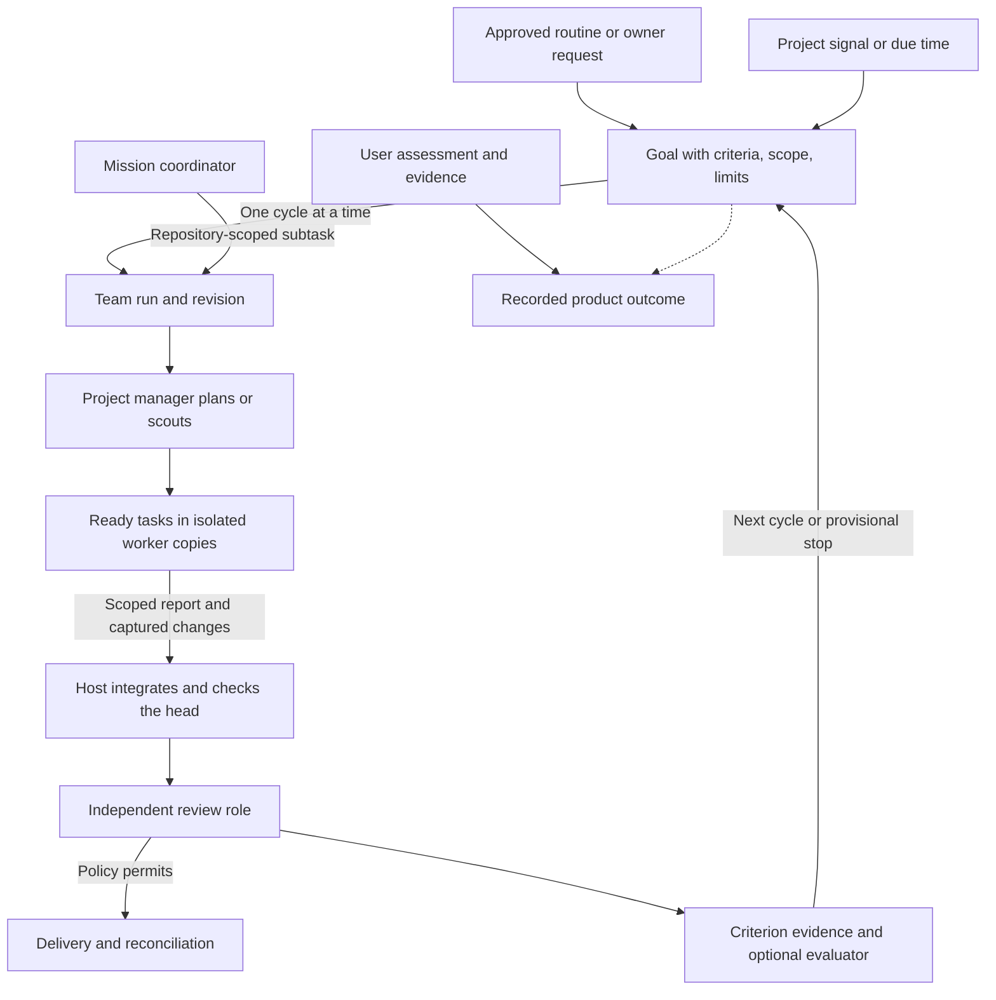

# How Infinite turns an objective into accountable work

Infinite has two control paths over the same execution engine. A **goal** pursues an approved outcome in sequential team cycles. A **mission** coordinates repository-specific subteams across a project. A standalone team can also handle a single request. A member is one assignment attempt. Its session runs the provider, and its report carries the attempt's identity. This distinction lets a run survive an agent being replaced.

All source locations below refer to Infinite main at `64956f4204cfbbc465eb95aecf64a9b6252916d2`, verified against the remote on 2026-11-24. Read a location from any checkout with `git show 64956f4204cf:<path>`. The main source is newer than the working checkout in which this research was written.

## Two routes to a team



A configured intake can start a mission from an authorized Linear issue or Slack request. It persists the request before launch and uses the original issue or thread for eligible questions and outcomes. The GitHub review-feedback path can also steer an existing delivered PR once for a qualifying owner review at its pinned head. These are distinct sources of new and continuing work. `intake.ts:374–412,706–735`, `team-review-feedback.ts:38–66`, `review-feedback.ts:132–179`.

An approved routine persists its next goal request before creation. On recovery it looks up that request ID. For a standing goal, a due time or a matching signal can make a cycle eligible. Signals from the goal's own runs are filtered and a batch can wake it once. The host checks the project mode, lineup, earlier failures, tracking, and launch fuse. A cycle pins its context and starting point before creating the team. An unresolved delivery can hold the goal between cycles. Three consecutive counted failures pause it. A finite autonomous goal may stop provisionally when its criteria are met. A cadence goal continues until policy or its owner stops it. See `packages/host/src/routines.ts:412–471`, `goals.ts:689–712,876–946,980–1042`, `goal-standing.ts:5–68` and `goal-verdicts.ts:25–46` in the same directory.

A mission determines which enrolled repositories must do work and in what order. The coordinator dispatches a dependency graph. The host reserves eligible repositories, persists the child create request, and reuses its identity if interrupted. A blocked child, child question, or finished subtask reaches the mission inbox. The coordinator can answer a child within its authority, steer it, or escalate a decision. A solo subtask has one writer slot. A team subtask can resize within its ceiling. Connecting two repositories in a mission preserves each repository's delivery and permission policy. See `docs/missions.md:13–22`, `packages/host/src/missions.ts:838–931,984–1006,1517–1539`.

## Who owns each fact

| Fact | Owner and how other actors use it |
| --- | --- |
| Approved objective and scope | The goal or run holds a versioned objective record when enabled. Criteria specify their producer, such as a host check, evaluator, or owner rating. Derived criteria must quote the objective or a direction. A coordinator can propose work and observations. The host validates the plan against goal paths and its established verification commands. `objective-types.ts:198–248,255–282`, `teams.ts:3178–3208`. |
| Task and assignment | The plan contains task ID, owned paths, dependencies, instructions, and optional profile/risk fields. The host picks a ready task only once its dependencies are integrated. Replacement members receive distinct attempt identities. The member reports through scoped MCP or a helper. The worker checks run, member, revision, report kind, and repeated request digest before acknowledging a journaled report. `team-types.ts:552–579`, `teams.ts:2585–2608,2713–2740`, `worker.ts:398–415`. |
| Process and conversation | The manager launches a detached worker. Its ordered, encrypted session journal and control receipts survive an API restart while that worker lives. The worker can expose a native provider session ID and negotiated capabilities. A host reboot, a lost worker, or a missing provider history needs its own recovery evidence. `manager.ts:1174–1219`, `worker.ts:119–124,1738–1767`, `vault.ts:82–126`, [earlier continuity review](../../native-continuity.md#applied-to-the-runner). |
| Work exchanged between agents | The saved run owns reports and integrated results. Optional blackboard tools provide scoped findings, handoffs, contracts, and blockers. Member posts enter the worker journal. The host validates and ingests them, and mirrors saved report, integration, check, and direction entries. A member claim can inform the next assignment. A host integration or check receipt establishes a different fact. `evidence/entry-types.ts:4–41`, `team-entry-route.ts:110–154`, `team-entry-ingest.ts:41–82`, `teams.ts:734–768`. |
| Run evidence and projections | Team, goal, and mission services keep their own sealed records. The evidence store appends typed events with unique keys and a monotonic sequence. The team writes its sealed state before flushing its outbox. Each projector advances its own cursor transactionally. A missing or lagging projection can be repaired from retained sources. Retention and refused events limit reconstruction. `teams.ts:734–758`, `vault.ts:54–79`, `evidence/store.ts:218–254,284–324`, `evidence/outbox.ts:38–55`. |
| Work tracking and outcome | For a mapped goal/run, Linear owns issue requirements and workflow state. The host stores its binding, refreshes parent and child, delivers evidence through an outbox, and holds new work on stale or blocked tracking. Intake-originated mission children can suppress team mirroring and use the intake issue. Separately, an eligible evaluator can issue a provisional verdict. Only an explicit human outcome with evidence records `achieved` through the owner/controller route. `linear.ts:189–206,231–258,303–325,345–358`, `missions.ts:875–881`, `goal-verdicts.ts:25–54`, `server.ts:1294`, `goals.ts:581–600`. |

Short source paths in the table and below are relative to `packages/host/src/` unless a different directory is named.

## Follow a report across a failure

Suppose two workers are implementing independent changes and the API restarts after the first reports. Its worker has already journaled the exact report. The team reads member events against its assignment and cursor. Identical resubmission is acknowledged by the worker. Once the host captures the change, it checks the scoped paths and integrates in order. It records the integrated task and commit. A downstream task can now become ready. After all tasks settle, the host checks the integration head. A reviewer working on an older head is refused. A successful review makes the code eligible for the repository's delivery policy. A later verdict may stop a finite autonomous goal provisionally. The host controls integration, eligibility and delivery. The evaluator and the owner record distinct judgments about the objective. `worker.ts:398–415`, `teams.ts:2542–2548,2597–2610,2750–2774,3384–3398,3439–3487,3589–3595`, `goal-verdicts.ts:37–43`.

The crash boundary matters. A validated member report can be read again. A Git push, provider input, or permission answer with an uncertain acknowledgement may already have had an effect. Recovery must inspect the relevant operation identity and evidence. A standing goal blocks on a reported merge whose baseline is unvalidated. Interactive permission delivery rechecks delegation, halt, current prompt, and control before sending a one-shot decision. An uncertain delivery can require the owner. A recommendation attached to an ordinary question is also just a recommendation until an authorized actor answers it. `goal-standing.ts:44–68`, `team-recovery.ts:229–278`, `permission-delivery.ts:201–283`, `question-recommendation.ts:3–17`.

## What limits unattended scale today

- **Admission measures launches.** The host fuse defaults to 30 launches per project and 80 per host in a rolling hour, with a permission-coordinator exemption. It records admissions by launch ID and can hold when its baseline cannot be read. The usage ledger shows measured or incomplete currency totals. The daily/weekly spend ceilings specified in the product contract would require additional admission logic. The current evidence-backed usage service can record Claude and Codex sessions with complete or partial coverage and metered OpenCode launches. An unsupported or unobserved session stays explicitly unmeasured. A short run and an expensive run each consume one launch slot. `usage-service.ts:60–73,95–105`, `fuse/rules.ts:17–32`, `fuse/types.ts:1–45`, `fuse/service.ts:144–159,197–241`, `docs/teams.md:2600–2634`, `PRODUCT.md:75–85`.
- **Reviewer identity matters after routing.** The delivery gate checks the pinned delivery policy, checked head, and approved review revision. Role selection assigns the configured reviewer. The auto-router screens the reviewer's exact model, and evaluator selection has its own independence rules. The inspected delivery gate does not compute coverage for every actual author's model family as required by the product contract. A differently named reviewer model can belong to a contributing family. This is a source finding about the host gate. External branch protections or a particular lineup may impose additional restrictions. `team-types.ts:274–335`, `teams.ts:1244–1248,2693–2710,3384–3419`, `routing-choice.ts:24–43`, `evaluator-profiles.ts:94–117`, `PRODUCT.md:77–85,105–116`.
- **A single runner schedules from its own records.** Goal, mission, and team services coalesce overlapping ticks and walk their in-memory records every 500 ms when a pass can start. The routine timer is one second. A host load gate can hold automatic starts on CPU or memory pressure. These bounds protect different resources. As retained run counts grow, measure scan work and time-to-admission before changing concurrency. Separate instances have separate state. A fleet provisioning plan does not elect a writer over shared work. `teams.ts:1894–1921`, `goals.ts:602–624`, `missions.ts:641–662`, `routines.ts:258–274`, `host-load.ts:40–70`, `docs/multi-tenant.md:64–83`.
- **The work board is a reader.** The Swarm view assembles sessions, teams, and a separately refreshed mission list. The host live feed already shares session/team change notifications and session journal cursors. Evidence projectors already exist. A cross-entity work feed would need defined coverage over goals, missions, tasks, and evidence, plus an explicit reset when retention or restore invalidates a cursor. `apps/web/src/swarm/SwarmView.tsx:47–75`, `live.ts:5–47`, `evidence/outbox.ts:38–55`, `docs/swarm.md:3–29`.

The separate operational study examines unavailable workers, pending operations, full-tree delivery validation, permission invalidation and workspace cleanup at this same revision. [Operational source checks](operations.md#which-operational-failures-survive-a-source-check).

## Working checkout and local checks

The checkout based on `706618164cce` has uncommitted changes for agent-managed worker capacity, mission subtask resizing, richer assignment briefs, and corresponding client controls. Main already includes the capacity feature (`1db2527b`) and has standing goals, signal consumption, criterion verdicts, a blackboard, and a Swarm view beyond that local base. The pending edits were inspected as a diff. Recommendations use the pinned main implementation.

A local probe submitted a strong lineup to `teamLineupSchema.parse()` with different writer and reviewer models from the same family. The schema accepted it, `familyOf()` returned the same family for both, and `screenProfiles()` returned no exclusion for the writer. This exercises lineup validation and worker selection. The delivery conclusion above comes from reading the gate. The probe did not request a merge.

On Node 22, the attention and remote packages were built in an isolated copy of main. The following existing tests passed **80/80** with zero skips. They exercise real scheduling, request replay and evidence rules with controlled clocks, storage, provider doubles, and a local Linear fixture as applicable. The team simulator ran its default 50 seeds with crash cuts and mutation checks. These results establish local invariants. Fleet throughput, live provider recovery, a real merge, and product impact remain unmeasured.

```sh
node --import tsx --test tests/standing-goals.test.ts tests/goal-verdicts.test.ts \
  tests/verdict-compose.test.ts tests/team-entry-route.test.ts tests/fuse-rules.test.ts \
  tests/linear-budget.test.ts tests/team-run-sim.test.ts
```
